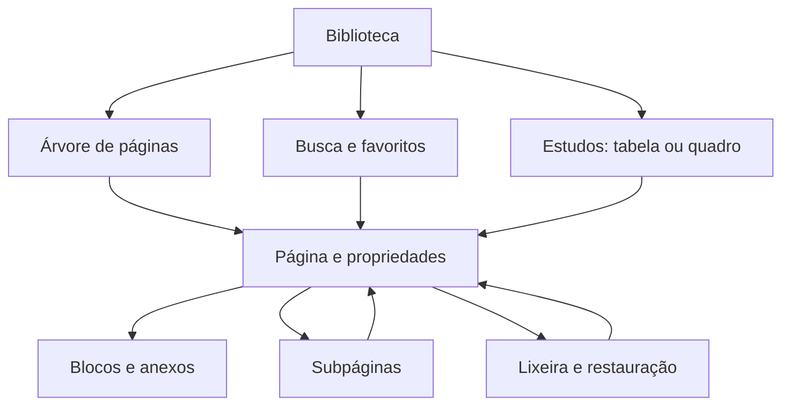
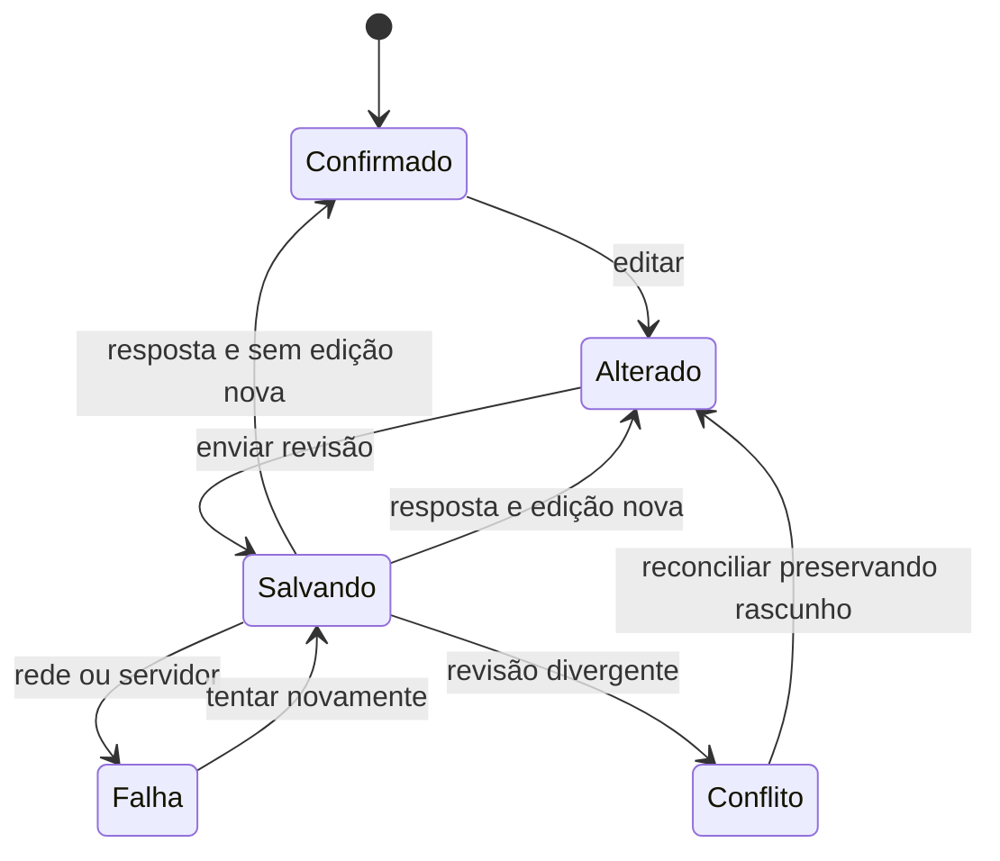
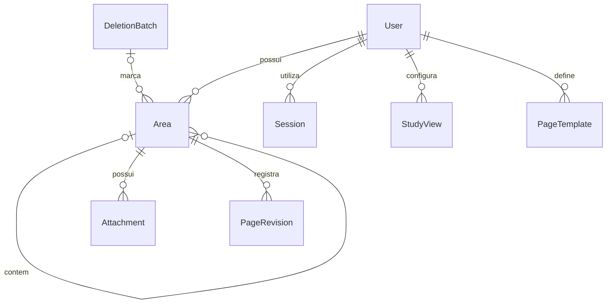
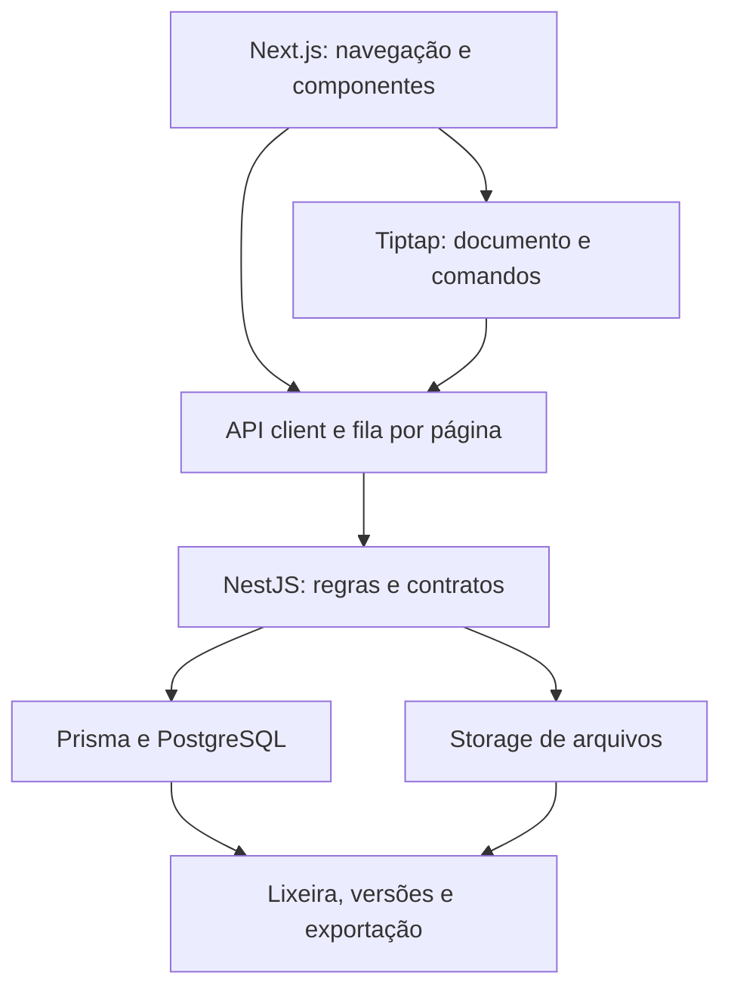

# Engenharia reversa do Notion aplicada à Biblioteca de Estudos

Versão 1.0 · 10/11/2026 · Análise e planejamento

Pacote estruturado: 15 documentos técnicos e um índice. Este arquivo reúne o conteúdo para leitura contínua. No ZIP, os documentos são separados e os links relativos do índice funcionam.

---

# 01. Resumo executivo

**Biblioteca de Estudos — evolução inspirada no Notion** 
Data: 10/11/2026. Estado: especificação proposta para revisão; nenhuma implementação realizada.

## Direção recomendada

Evoluir o projeto existente para uma biblioteca pessoal de páginas hierárquicas, com editor por blocos, materiais anexados e acompanhamento de estudo. “Simplificada, porém completa” significa concluir o ciclo de organizar → escrever → relacionar → encontrar → revisar → recuperar/exportar dentro desse domínio. Não significa reproduzir todo o produto Notion.

Um exemplo da organização proposta é **Projetos → Desenvolvimento web → Backend → Terminal → Exercícios**. Cada nível é uma página que pode ter conteúdo e páginas filhas. Idiomas, Faculdade, Projetos e Outros continuam como entradas da biblioteca. Estudando/Estudado passam a funcionar também como filtros e propriedades, sem obrigar a pessoa a atravessar essas telas para abrir uma anotação.

## O que foi confirmado

- No vídeo: tema escuro, páginas com capa/ícone, hierarquia de páginas, referência a subpágina no conteúdo, menus contextuais, opções de transformação e cor, seletor de linguagem de código, navegação por caminho, páginas vazias e personalização. Muitas opções apenas aparecem; sua execução não é demonstrada.
- No repositório: Next.js/React, Tiptap, NestJS, Prisma/PostgreSQL; entidades Area, Attachment, User e Session; seções/status fixos; anexos; fila de salvamento e verificação condicional de conflito. Evidência de código não equivale a homologação em produção.
- A base analisada foi `main`, commit `ccecca35a828da4c19015ba51874da3cf09e10a1`. A comparação remota mostrou `refactor/cleanup-general` um commit atrás dessa base, sem alterações exclusivas na comparação. Nenhum branch foi modificado.

## O que mais precisa mudar

| Dimensão | Situação constatada | Evolução proposta |
|---|---|---|
| Organização | Area sem relação pai/filho | Preservar Area e adicionar hierarquia |
| Navegação | Estados React na página principal | Rotas por ID, árvore lateral e caminho clicável |
| Editor | Texto rico; controles em painéis | Inserção contextual, ações por bloco e blocos de estudo |
| Busca | Filtra os itens carregados da listagem | Busca no servidor, em todas as páginas do proprietário |
| Salvamento | Fila existente, conflitos condicionais | Revisão obrigatória nas escritas e saída protegida |
| Exclusão | Remoção de registros e arquivos | Lixeira recuperável antes da exclusão definitiva |
| Anexos | Painel vinculado à Area | Reuso do painel e referências por ID no conteúdo |
| Visualizações | Listagem e filtros fixos | Tabela e quadro sobre os mesmos registros, numa segunda entrega |

## Vocabulário que evita erros de arquitetura

- **Página:** documento completo; corresponde à Area existente.
- **Bloco:** parágrafo, título, código, imagem, tarefa ou referência dentro do documento Tiptap. Não criar uma Area para cada parágrafo.
- **Subpágina:** outra Area cujo `parentId` aponta para a página mãe.
- **Metadados:** informações sobre a página: categoria, status e nível de entendimento.
- **Visualização:** maneira de mostrar os mesmos dados; alternar tabela/quadro não cria cópias das páginas.
- **MVP:** primeira versão que já permite concluir o fluxo principal com persistência e recuperação.
- **Migração:** transformação controlada do banco/conteúdo existente para o novo formato.
- **Controle de concorrência:** evita que uma aba sobrescreva silenciosamente o trabalho de outra.

## Duas entregas com fronteiras claras

**MVP — RF-001 a RF-010 e RF-012 a RF-018:** preservar dados, criar páginas, organizar subpáginas, navegar, editar blocos essenciais, código e tarefas, anexar materiais, criar links internos, salvar com segurança, pesquisar, favoritar e recuperar da lixeira. O ícone simples existente continua funcionando. Os requisitos não funcionais críticos fazem parte dessa entrega.

**Versão completa simplificada — acrescentar RF-011 e RF-019 a RF-026:** capa/seletor de ícone, duplicação independente, alternantes e destaques, arrastar com alternativa acessível, tabela/quadro de estudos, filtros salvos, modelos, exportação portátil e versões manuais recuperáveis.

**Fora das duas entregas:** colaboração simultânea, espaços de equipe, compartilhamento público, comentários entre usuários, IA/agentes, calendário externo, fórmulas, relações/rollups arbitrários, marketplace, blocos sincronizados, layouts de múltiplas colunas, modo offline com sincronização e clonagem integral de bases do Notion. Essas funções foram registradas quando visíveis; não foram apagadas da análise.

## Critério de sucesso

O usuário consegue criar uma página de estudo com subpáginas, escrever e reorganizar conteúdo, anexar e reencontrar material, mudar de tela sem perda silenciosa, reabrir após recarregar e restaurar uma exclusão. Na segunda entrega, consegue também visualizar o estudo em tabela/quadro e levar uma cópia dos dados e arquivos consigo.

A prioridade é concluir esses fluxos. Sem eles, semelhança visual não demonstra uma biblioteca completa.

---

# 02. Inventário de evidências e cobertura

## Método e limites

O vídeo foi decodificado localmente e examinado por quadros em ordem temporal: amostragem geral de seis em seis segundos e quadros adicionais nas transições. Os intervalos abaixo delimitam os quadros examinados; não medem a duração exata dos cliques. Menus abertos comprovam disponibilidade visual de opções, não o sucesso de cada ação. Não houve navegação interativa na conta nem inspeção de tráfego/DOM do Notion.

O arquivo contém áudio AAC. A faixa não foi transcrita nem usada como evidência verbal; a análise comportamental é visual. Não se afirma que o vídeo seja silencioso. Quadros intermediários podem conter ações rápidas não capturadas. Conteúdos privados incidentais não foram transcritos nem incorporados aos entregáveis; as capturas são apenas material de análise.

O texto anexado é a metodologia, não uma descrição funcional do Notion. A documentação oficial complementa lacunas e recebe fonte própria. O código foi lido estaticamente em um commit fixo; não foram executados app, testes ou migrações.

## Classificação

| Rótulo | Uso |
|---|---|
| OBSERVADO | Visto diretamente no vídeo, código ou texto de documentação; o tipo de fonte é sempre indicado |
| INFERIDO | Interpretação plausível que ainda precisa de confirmação |
| PROPOSTO | Decisão para a Biblioteca; não descreve obrigatoriamente o Notion |
| NÃO DETERMINADO | Sem evidência suficiente, inclusive resultado de ações apenas listadas |

Confiança alta significa leitura direta e clara do item especificado; média, contexto/transição parcial; baixa, indícios insuficientes. Confiança na identificação de um menu não se estende à sua persistência. Todos os requisitos da nova aplicação são **PROPOSTOS**, mesmo quando sua origem é uma observação.

## Fontes primárias

| ID | Material | Alcance e limitação |
|---|---|---|
| USR-01 | Solicitação desta conversa | Notion como referência, projeto existente como base; objetivo “simplificada, porém completa” |
| DOC-01 | Texto colado(20261110-135433).txt | Prompt de engenharia reversa, fases 0–13; determina planejar antes de implementar |
| VIDEO-01 | 2026-11-10 10-40-16.mp4 | 192,43 s; 1280×720; H.264, 30 fps; 148.297.906 bytes; navegador desktop, tema escuro |
| NTC-01 | Consultas pelo conector Notion: Biblioteca; Terminal | Sem resultados nessas consultas. Não comprova inexistência das páginas nem equivalência entre a conexão e o workspace gravado |
| REP-00 | Repositório e branches consultados em 10/11/2026 | main fixada no commit indicado; produção e alterações locais não examinadas |

[Repositório na revisão analisada](https://github.com/Erik02T/Biblioteca_de_Estudos/tree/ccecca35a828da4c19015ba51874da3cf09e10a1).

## Catálogo visual

| ID | Localização em VIDEO-01 | Descoberta e limite | Classe | Confiança | Dependência |
|---|---|---|---|---|---|
| EV-001 | 00:00–00:08 | Página Terminal com capa, ícone, título, texto, caminho superior e lateral | OBSERVADO | Alta | — |
| EV-002 | 00:10–00:12 | Menu da referência EX-Terminal; transformação, cor, ícone, favoritos, renomear, abrir, copiar link, duplicar, mover, lixeira e IA disponíveis visualmente | OBSERVADO | Alta | EV-001 |
| EV-003 | 00:14–00:18 | Submenu de tipos: texto, títulos 1–4, página, listas, tarefas, alternantes, código, citação, destaque, equação, sincronizado, títulos alternantes e 2–5 colunas | OBSERVADO | Alta | EV-002 |
| EV-004 | 00:20–00:26 | Submenu separa cor de texto e cor de fundo; há indicação de cor usada por último | OBSERVADO | Alta | EV-002 |
| EV-005 | 00:28–00:32 | Seletor de emoji/ícone aberto para a referência; filtro e categorias visíveis | OBSERVADO | Alta | EV-002 |
| EV-006 | 00:34–00:44 | Retorno à página e reabertura do menu; execução de duplicar/mover/excluir não comprovada | OBSERVADO | Alta para menu | EV-002 |
| EV-007 | 00:48–01:02 | Rolagem de texto longo com títulos, listas, separadores e caixas de código | OBSERVADO | Alta | EV-001 |
| EV-008 | 01:04–01:10 | Seletor de linguagem do código aberto; pesquisa, lista de linguagens e controle de copiar visíveis | OBSERVADO | Alta | EV-007 |
| EV-009 | 01:18–01:32 | Menus em cascata do caminho superior expõem vários níveis até EX-Terminal | OBSERVADO | Alta | EV-001 |
| EV-010 | 01:42–01:46 | Referência EX-Terminal precede transição por tela de carregamento e abertura da página com esse título | OBSERVADO | Alta para sequência; média para gesto exato | EV-002 |
| EV-011 | 01:46–01:58 | Página filha com texto, código inline, listas e blocos; árvore lateral expandida | OBSERVADO | Alta | EV-010 |
| EV-012 | 02:00–02:12 | Navegação entre outras páginas pela lateral; uma página contém material privado incidental, omitido | OBSERVADO | Alta | EV-011 |
| EV-013 | 02:14–02:16 | Página “Nova página” aberta, com título vazio/placeholder e sugestões de início | OBSERVADO | Alta | EV-012 |
| EV-014 | 02:18–02:20 | Menu da guia inicial: renomear, excluir guia e personalização da lateral | OBSERVADO | Alta | EV-013 |
| EV-015 | 02:22–02:24 | Tela de novo chat com campo de entrada; nenhum prompt/resposta executado na amostragem | OBSERVADO | Alta | — |
| EV-016 | 02:26 | Tela Biblioteca do Notion com abas e listagem de espaço de equipe | OBSERVADO | Alta | — |
| EV-017 | 02:28–02:34 | Retorno a página vazia; duas entradas “Nova página” ficam visíveis na lateral | OBSERVADO | Alta | EV-013 |
| EV-018 | 02:36–02:44 | Menu do workspace com opções de configurações, membros/conexões e troca de contexto | OBSERVADO | Média: menu parcial | — |
| EV-019 | 02:48–02:52 | Menu da seção particular oferece alternativas de ordenação, inclusive manual | OBSERVADO | Alta para opções | EV-017 |
| EV-020 | 02:58–03:04 | Controles de personalização precedem página com capa lunar e ícone de lua; seletor de ícones aberto | OBSERVADO | Alta para antes/depois; média para seleção exata | EV-013 |
| EV-021 | 03:06–03:12 | Capa/ícone continuam visíveis; campo de comentário aberto e vazio | OBSERVADO | Alta | EV-020 |
| EV-022 | 00:00–03:12 | Controles de compartilhar, favoritos, busca e sumário lateral aparecem; uso completo desses controles não demonstrado | OBSERVADO | Alta para presença | EV-001 |

## Evidência do projeto existente

Todos os caminhos abaixo são relativos ao repositório na revisão REP-00. Os intervalos indicam localização aproximada; o link é para o arquivo versionado completo.

| ID | Arquivo/local | Constatação estática | Confiança |
|---|---|---|---|
| REP-01 | backend/prisma/schema.prisma, modelos a partir da linha 28 | Quatro modelos: Area, Attachment, User, Session. Area não possui parentId, capa, lixeira ou modelo genérico de coleção | Alta |
| REP-02 | backend/src/areas/areas.service.ts, findAll/update/remove; areas.controller.ts | CRUD, paginação, ordenação por atualização/ID, ownership; DELETE apaga objetos e registro | Alta |
| REP-03 | frontend/src/app/page.tsx, Home/AreaForm, linhas 100–175 e 265–431 | Navegação por estado, filtro sobre áreas carregadas, sidebar do editor com item atual/índice | Alta |
| REP-04 | frontend/src/app/extensions.ts; page.tsx, retorno de AreaForm | StarterKit e Highlight; headings 1–6; painel ativo desabilita underline/link, embora exista componente alternativo com outros botões | Alta |
| REP-05 | serialized-save-queue.ts; page.tsx, linhas 265–325; areas.service.ts, linhas 75–118 | Serialização no cliente; autosave de conteúdo existente com atraso de 700 ms; conflito se updatedAt enviado; API aceita escrita sem essa precondição | Alta |
| REP-06 | backend/src/attachments/attachments.service.ts; page.tsx, uploadAttachment | Upload e metadados, URLs assinadas no retorno, compensação de upload; anexar exige Area já salva | Alta |
| REP-07 | frontend/package.json; backend/package.json | Dependências declaradas confirmam a stack do projeto, não a stack do Notion | Alta |
| REP-08 | .github/workflows/ci.yml; frontend/AGENTS.md | Pipeline declara lint/testes/build; guia local da versão de Next deve ser lido antes de implementar | Alta |
| REP-09 | create-area.dto.ts; update-area.dto.ts | Nome/categoria obrigatórios, nível 0–5, conteúdo como objeto com limite declarado de 50 MiB; não há validação completa de árvore do editor nesse DTO | Alta |

Não inferir testes aprovados a partir da existência dos arquivos. Também não presumir que um componente isolado seja o editor usado: o fluxo ativo está em AreaForm de page.tsx.

## Documentação oficial consultada

| ID | Fonte e localização | Informação aproveitada |
|---|---|---|
| WEB-01 | [Escrita e edição](https://www.notion.com/help/writing-and-editing-basics), menus/blocos | Confirma edição por blocos e comandos de inserção; complementa, sem substituir, o vídeo |
| WEB-02 | [Subpáginas](https://www.notion.com/help/create-a-subpage), criação/navegação | Documenta páginas aninhadas, lateral e caminho de navegação |
| WEB-03 | [Introdução a bases](https://www.notion.com/help/intro-to-databases), características | Itens são páginas com propriedades; essa capacidade não foi exercitada no vídeo |
| WEB-04 | [Visualizações, filtros e ordenação](https://www.notion.com/help/views-filters-and-sorts), configurações de visualização | Diferentes apresentações dos mesmos dados e ajustes por visualização |
| WEB-05 | [Personalizar página](https://www.notion.com/help/customize-your-page) | Consulta tentada sem conteúdo utilizável; não usada para sustentar requisitos. Capa/ícone vêm do vídeo |
| WEB-06 | [WCAG 2.2](https://www.w3.org/TR/WCAG22/), 2.1.1, 2.4.7, 2.4.11 e 2.5.7 | Referência para teclado, foco e alternativa a arrastar |
| WEB-07 | [OWASP ASVS](https://asvs.owasp.org/) | Referência de verificação de segurança; a página oficial apresenta ASVS 5.0.0 |

## Cobertura por módulo

Alta: vários estados e transições legíveis. Média: estrutura e alguns estados, sem ciclo completo. Baixa: opção isolada, documentação externa ou ausência de demonstração.

| Módulo | Cobertura | Motivo |
|---|---|---|
| Leitura e navegação hierárquica | Alta | Páginas distintas, caminho e árvore visíveis |
| Edição e ações por bloco | Média | Menus claros, mas pouca edição efetiva demonstrada |
| Personalização de página | Média | Antes/depois de capa/ícone; persistência após recarga não vista |
| Criação de página | Média | Páginas vazias novas; validações, erros e salvamento não demonstrados |
| Biblioteca/lateral | Média | Vários menus e tela agregadora; filtros não exercitados |
| Busca, favoritos, lixeira, exportação | Baixa | Controles/opções sem fluxo comprovado ou ausentes |
| Bases e visualizações | Baixa | Complementação documental; nenhum uso no vídeo |
| IA, colaboração, responsividade, offline | Baixa | Entradas de interface ou ausência de evidência |
| Integração futura com o projeto | Média | Código relevante lido; não houve execução ou prova de migração |

## Links diretos dos arquivos inspecionados

- [README.md](https://github.com/Erik02T/Biblioteca_de_Estudos/blob/ccecca35a828da4c19015ba51874da3cf09e10a1/README.md)
- [frontend/AGENTS.md](https://github.com/Erik02T/Biblioteca_de_Estudos/blob/ccecca35a828da4c19015ba51874da3cf09e10a1/frontend/AGENTS.md)
- [frontend/package.json](https://github.com/Erik02T/Biblioteca_de_Estudos/blob/ccecca35a828da4c19015ba51874da3cf09e10a1/frontend/package.json)
- [backend/package.json](https://github.com/Erik02T/Biblioteca_de_Estudos/blob/ccecca35a828da4c19015ba51874da3cf09e10a1/backend/package.json)
- [backend/prisma/schema.prisma](https://github.com/Erik02T/Biblioteca_de_Estudos/blob/ccecca35a828da4c19015ba51874da3cf09e10a1/backend/prisma/schema.prisma)
- [backend/src/areas/areas.controller.ts](https://github.com/Erik02T/Biblioteca_de_Estudos/blob/ccecca35a828da4c19015ba51874da3cf09e10a1/backend/src/areas/areas.controller.ts)
- [backend/src/areas/areas.service.ts](https://github.com/Erik02T/Biblioteca_de_Estudos/blob/ccecca35a828da4c19015ba51874da3cf09e10a1/backend/src/areas/areas.service.ts)
- [backend/src/areas/dto/create-area.dto.ts](https://github.com/Erik02T/Biblioteca_de_Estudos/blob/ccecca35a828da4c19015ba51874da3cf09e10a1/backend/src/areas/dto/create-area.dto.ts)
- [backend/src/areas/dto/update-area.dto.ts](https://github.com/Erik02T/Biblioteca_de_Estudos/blob/ccecca35a828da4c19015ba51874da3cf09e10a1/backend/src/areas/dto/update-area.dto.ts)
- [frontend/src/app/page.tsx](https://github.com/Erik02T/Biblioteca_de_Estudos/blob/ccecca35a828da4c19015ba51874da3cf09e10a1/frontend/src/app/page.tsx)
- [frontend/src/app/EditorLayout.tsx](https://github.com/Erik02T/Biblioteca_de_Estudos/blob/ccecca35a828da4c19015ba51874da3cf09e10a1/frontend/src/app/EditorLayout.tsx)
- [frontend/src/app/AreaEditor.tsx](https://github.com/Erik02T/Biblioteca_de_Estudos/blob/ccecca35a828da4c19015ba51874da3cf09e10a1/frontend/src/app/AreaEditor.tsx)
- [frontend/src/app/extensions.ts](https://github.com/Erik02T/Biblioteca_de_Estudos/blob/ccecca35a828da4c19015ba51874da3cf09e10a1/frontend/src/app/extensions.ts)
- [frontend/src/app/serialized-save-queue.ts](https://github.com/Erik02T/Biblioteca_de_Estudos/blob/ccecca35a828da4c19015ba51874da3cf09e10a1/frontend/src/app/serialized-save-queue.ts)
- [backend/src/attachments/attachments.service.ts](https://github.com/Erik02T/Biblioteca_de_Estudos/blob/ccecca35a828da4c19015ba51874da3cf09e10a1/backend/src/attachments/attachments.service.ts)
- [.github/workflows/ci.yml](https://github.com/Erik02T/Biblioteca_de_Estudos/blob/ccecca35a828da4c19015ba51874da3cf09e10a1/.github/workflows/ci.yml)

---

# 03. Mapa de módulos e páginas

## Decomposição da referência

| Módulo | Páginas/seções observadas | Componentes/interações | Evidências |
|---|---|---|---|
| NAV | Lateral, particular, espaço de equipe e caminho superior | Árvore, expansão, menus e navegação | EV-001, EV-009, EV-011–019 |
| PAGE | Terminal, EX-Terminal, Backend e Nova página | Capa, ícone, título, conteúdo e sugestões iniciais | EV-001, EV-010–013, EV-020 |
| EDIT | Corpo e menus de blocos | Conversão, cor, ícone e código | EV-002–008 |
| LIB | Tela Biblioteca | Abas, listagem e ação de novo espaço | EV-016 |
| AUX | Novo chat e comentário vazio | Campo de entrada e sugestões; resultado desconhecido | EV-015, EV-021 |

A tela “Biblioteca” do Notion agrega recursos do workspace; ela não é o mesmo produto que a Biblioteca de Estudos. Uma listagem visual nessa tela não prova que o usuário criou uma base de dados.

## Estrutura proposta para a Biblioteca

| ID | Módulo | Páginas/rotas propostas | Dados | Dependências |
|---|---|---|---|---|
| MOD-01 | Início e navegação | /biblioteca; seção por parâmetro; favoritos/recentes | Resumo das Areas | MOD-02 |
| MOD-02 | Páginas e hierarquia | /biblioteca/paginas/:id | Area, parentId, posição | Base de dados e propriedade do usuário |
| MOD-03 | Editor | Corpo da página, menu /, menu de bloco | JSON Tiptap | MOD-02, MOD-04 |
| MOD-04 | Materiais | Painel de anexos e inserção inline | Attachment | MOD-02, storage atual |
| MOD-05 | Descoberta | Busca global e índice da página | Texto indexável, títulos, favoritos | MOD-02, MOD-03 |
| MOD-06 | Recuperação | /biblioteca/lixeira; versões da página | Lotes de exclusão e PageRevision | MOD-02, controle de versão |
| MOD-07 | Acompanhamento | /biblioteca/estudos; tabela/quadro | Mesmas Areas e StudyView | MOD-02, metadados |
| MOD-08 | Reuso e portabilidade | Modelos; exportar | PageTemplate e pacote de exportação | MOD-03, MOD-04, MOD-06 |

Rotas acima são propostas, não rotas observadas do Notion. Endpoints existentes de /areas podem ser mantidos por compatibilidade.

## Usuários

O perfil alvo é o proprietário de uma biblioteca pessoal autenticada. A infraestrutura pode atender várias contas isoladas. Não há editor convidado, administrador de equipe ou colaboração na versão proposta. Tais perfis aparecem na referência, mas ampliariam permissões e recuperação de conflitos sem necessidade demonstrada pelo objetivo de estudo pessoal.

## Hierarquia funcional

Exemplo proposto: Aplicação → Páginas → Página Terminal → Corpo → Bloco de código → Seletor de linguagem → Ação escolher linguagem → Atualização do documento → Salvamento confirmado. O bloco é parte do documento; a subpágina Exercícios é outra página. Alterar apresentação não deve trocar essa identidade.

---

# 04. Catálogo de componentes

O quadro separa o que é visível na referência do que precisa ser projetado. As interfaces e propriedades de componentes são propostas de implementação, não extraídas do código do Notion.

| ID | Componente | Props/dados e eventos propostos | Estados observados | Estados a construir/verificar | Reuso e origem |
|---|---|---|---|---|---|
| CMP-01 | AppShell | página ativa, lateral aberta; alternar lateral | Desktop escuro | Lateral em gaveta, foco e carregamento | Global; EV-001 |
| CMP-02 | PageTree | id, título, ícone, filhos, expanded; abrir/criar/mover | Árvore expandida, item ativo | Erro, vazio, paginação de filhos, teclado | Navegação e seletor de destino; EV-011 |
| CMP-03 | Breadcrumbs | ancestrais; abrir nível/mostrar irmãos | Caminho e menus em cascata | Truncamento acessível, overflow | Todas as páginas; EV-009 |
| CMP-04 | PageHeader | título, ícone, capa, posição da capa; atualizar | Com/sem capa, placeholder | Upload, falha e remoção | Páginas; EV-001, EV-013, EV-020 |
| CMP-05 | PageProperties | seção, categoria, status, entendimento | Não demonstrado como estudo no Notion | Validação, alteração pendente e erro | Página/tabela; REP-01, REP-03 |
| CMP-06 | BlockEditor | documento, schemaVersion; transação | Leitura com diversos blocos | Vazio, seleção, composição japonesa, colagem | Página/modelos; EV-007, REP-04 |
| CMP-07 | CommandMenu | consulta, posição, opções; inserir/cancelar | Menu / não mostrado no vídeo | Abrir por / ou +, filtrar, setas, Enter/Esc | Editor; WEB-01; PROPOSTO |
| CMP-08 | BlockMenu | blockId, tipo; converter/duplicar/mover/apagar | Selecionado, submenus, hover | Undo, alternativa por teclado e conversão inválida | Editor; EV-002–006 |
| CMP-09 | ColorPicker | cor de texto/fundo; escolher/remover | Paletas separadas e recente | Contraste, foco, seleção anunciada | Texto/blocos; EV-004 |
| CMP-10 | IconPicker | emoji/ícone; pesquisar/escolher/remover | Popover, categorias, filtro | Teclado e erro de imagem, se suportada | Cabeçalho/árvore; EV-005, EV-020 |
| CMP-11 | CodeBlock | texto, linguagem; copiar/alterar linguagem | Caixa, lista de linguagens | Clipboard negado, texto copiado, linguagem desconhecida | Editor; EV-008 |
| CMP-12 | PageReference | targetPageId; abrir | Referência com ícone/nome | Destino na lixeira ou indisponível | Editor; EV-010 |
| CMP-13 | AttachmentCard | attachmentId, tipo, nome; abrir/remover | Não exercitado no vídeo | Progresso, falha, URL expirada, nova tentativa | Painel e corpo; REP-06 |
| CMP-14 | SearchDialog | consulta, filtros, cursor; abrir resultado | Apenas entrada de busca | Buscando, vazio, erro, resultado e paginação | Global; EV-022; PROPOSTO |
| CMP-15 | SaveIndicator | estado e revisão confirmada | Não determinado no vídeo | Editando, salvando, salvo, erro, conflito | Cabeçalho; REP-05 |
| CMP-16 | TrashDialog | raiz/lote, quantidade afetada; restaurar/excluir | Apenas opção de lixeira no menu | Confirmação, falha, restauração parcial proibida | MOD-06; EV-002; PROPOSTO |
| CMP-17 | StudyCollection | pages, view; editar metadados/abrir | Não demonstrado no vídeo | Tabela/quadro, vazio, filtros e conflito | MOD-07; WEB-03/04; PROPOSTO |
| CMP-18 | TemplateRevisionPicker | modelos ou versões; aplicar/restaurar | Não demonstrado | Preview, confirmação, erro e cancelamento | MOD-06/08; PROPOSTO |

Menus reutilizam a mesma infraestrutura de popover e foco. Indicadores de erro não devem desaparecer ao abrir outro menu. A seleção de texto deve ser preservada quando a pessoa usa a barra de formatação. A revisão arquitetural deve aproveitar EditorLayout, AttachmentsPanel e FormatPanel onde fizer sentido, sem manter a lógica inteira concentrada em page.tsx.

---

# 05. Especificação visual e design system

## Observado

VIDEO-01 usa fundo escuro, superfícies de menus ligeiramente mais claras, texto branco/cinza, bordas discretas, ícones compactos e azul para seleção. O documento ocupa uma coluna central, a capa é mais larga que o texto e a árvore fica na esquerda. Há rolagem vertical de documento longo e menus sobrepostos. A captura inclui navegador e barra do sistema, que não pertencem à aplicação.

Não foram obtidos CSS, fontes instaladas, escala do sistema ou zoom do navegador. Por isso, nenhuma medida em pixels da gravação é declarada como token original do Notion. O tamanho da fonte e o espaçamento exatos permanecem NÃO DETERMINADOS. Não houve tela móvel nem troca de tema observada.

## Tokens propostos para a Biblioteca

Estes valores são pontos de partida para protótipo e aferição de contraste, não medições da referência.

| Token | Proposta | Motivo |
|---|---|---|
| canvas | #17191D | Base escura com foco na leitura |
| surface/menu | #22252B / #292D35 | Separar navegação e popovers |
| text / muted | #F3F4F6 / #B6BDC9 | Hierarquia sem depender apenas da cor |
| accent / selection | #8AB4FF / #233653 | Foco e seleção visíveis |
| border | #444B58 | Delimitação de controles; validar em contexto |
| danger | #FF8F8F | Mensagens e exclusão, sempre acompanhadas de texto |
| Tipografia | Fonte de sistema com fallback japonês; monospace para código | Evitar downloads obrigatórios e preservar conteúdo multilíngue |
| Texto base | 16 px, entrelinha 1,6 | Proposta de leitura confortável, ajustável |
| Espaçamento | 4, 8, 12, 16, 24, 32, 48 px | Escala comum para componentes |
| Raios | 6 px controles; 10 px menus | Consistência visual |
| Largura de leitura | Máximo de 760 px; opção ampla na segunda entrega | Reduzir linhas muito longas |
| Lateral | Cerca de 248 px no desktop; gaveta em telas estreitas | Acesso à árvore sem comprimir o texto |
| Capa | Faixa proporcional com recorte ajustável | Separar identidade visual de conteúdo |

Definir temas por tokens sem repetir cores nos componentes. O tema escuro é a referência inicial; tema claro não integra os critérios mínimos desta versão. Preservar os elementos de identidade da Biblioteca e usar imagens próprias ou autorizadas, sem reutilizar as capas do vídeo.

## Layout e comportamento propostos

- Desktop: lateral recolhível, cabeçalho com caminho, coluna de leitura e ferramentas contextuais. O painel atual de anexos pode abrir sob demanda.
- Tela estreita: documento em uma coluna, navegação em gaveta; menus cabem na viewport e devolvem foco ao gatilho.
- Código e tabelas largas: rolagem interna identificável; a página não deve ganhar rolagem horizontal por esses elementos.
- Estados: seleção, foco e hover têm tratamentos distintos. Uma falha de salvamento permanece legível e não é representada somente por uma bolinha colorida.
- Reorganização: arrastar é um acelerador; “Mover acima/abaixo” e “Mover para…” também resolvem a ação.

A implementação deve ser comparada em dimensões equivalentes ao vídeo e em viewport estreita. As larguras são metas de projeto revisáveis; não promessas de fidelidade pixel a pixel.

---

# 06. Matriz de interações e estados

Ator das interações observadas: pessoa operando o Notion no vídeo. Pré-condição comum: sessão existente e página acessível. As exceções de servidor, teclado e persistência não foram exercitadas.

| ID | Origem/elemento | Antes → ação → depois | Feedback visto | Evidência/confiança | O que não se sabe |
|---|---|---|---|---|---|
| INT-001 | Referência de subpágina | Página → acionar contexto → menu de página | Seleção azul e popover | EV-002; alta | Botão/atalho exato que abriu; resultado de excluir/mover |
| INT-002 | Transformar em | Menu → abrir submenu → lista de tipos | Linha selecionada, preview de opção | EV-003; alta | Conversão efetiva e preservação de conteúdo |
| INT-003 | Cor | Menu → abrir Cor → paletas de texto/fundo | Hover e opções | EV-004; alta | Persistência e alcance de uma escolha |
| INT-004 | Editar ícone | Menu → abrir seletor → grade de emojis | Filtro e categorias | EV-005; alta | Busca e mudança específica nesse trecho |
| INT-005 | Documento | Página longa → rolar → outras seções | Viewport muda; lateral permanece | EV-007; alta | Comportamento em mobile |
| INT-006 | Bloco de código | Código → abrir linguagem → lista pesquisável | Popover de linguagem | EV-008; alta | Linguagem aplicada, copiar e feedback de sucesso |
| INT-007 | Caminho superior | Documento → explorar ancestrais → menus em cascata | Níveis revelados | EV-009; alta | Operações de movimentação estrutural |
| INT-008 | Referência EX-Terminal | Página mãe → ativar referência → carregamento → página filha | Placeholder e novo título | EV-010/011; alta para estados | Requisições e estratégia de cache |
| INT-009 | Lateral | Documento → selecionar outro item → outra página | Item/página mudam | EV-012; alta | Estado de edição pendente nessa troca |
| INT-010 | Nova página | Navegação → criação aparente → editor vazio | Placeholder e sugestões | EV-013/017; média para gatilho | Transação de criação, defaults e recarga |
| INT-011 | Guia inicial | Página → menu de guia → opções | Menu de personalização | EV-014; alta | Renomear/excluir guia realmente executados |
| INT-012 | Novo chat / Biblioteca | Lateral → navegação → chat vazio ou listagem | Tela correspondente | EV-015/016; alta | IA respondendo e operações na biblioteca |
| INT-013 | Workspace / particular | Lateral → menus → opções de contexto/ordem | Popovers | EV-018/019; média/alta | Resultado de alterações e permissões |
| INT-014 | Cabeçalho vazio | Página sem capa → personalização → capa e ícone visíveis | Cabeçalho redesenhado | EV-020; alta para resultado | Origem da imagem, upload e durabilidade após recarga |
| INT-015 | Comentário | Página → abrir comentário → campo vazio | Avatar/campo e separador | EV-021; alta | Envio, destinatários e discussão |

## Estados propostos do salvamento

Este diagrama é PROPOSTO, derivado das necessidades de REP-05. “Confirmado” exige resposta do servidor para o conteúdo e os metadados em questão. Rascunho de página nova precisa obter ID antes de anexos e referências. Conflito nunca autoriza reenvio cego que sobrescreva a outra versão.

## Estados propostos da página e anexos

Página: criando → ativa → na lixeira → restaurada ou excluída definitivamente. Erro de criação mantém o texto local e oferece nova tentativa idempotente. Página com ancestor na lixeira não pode aparecer por busca ou link ativo.

Anexo: selecionado → enviando → registrado → disponível. Falha de upload ou de registro não cria um bloco quebrado definitivo; erro é visível e reversível. URL assinada expirada deve ser renovada mediante nova autorização, sem regravar a URL temporária no documento.

## Regras de interação propostas

No editor, `/` abre comandos apenas no contexto apropriado e fora de composição de caracteres. Fora do editor, a busca pode usar Ctrl/Cmd+K. Esc fecha primeiro o menu/modal em foco; não abandona automaticamente a página. Desfazer edição local é diferente de recuperar uma versão já salva. “Voltar” ou “Fechar” não promete reverter o autosave.

---

# 07. Fluxos e casos de uso

Todos os casos abaixo são PROPOSTOS. O proprietário autenticado é o ator principal.

## UC-001 — Organizar um assunto

Origem: EV-009–013, REP-01/03. Requisitos: RF-001–005, RF-014, RF-018.

1. Abrir Projetos e criar a página “Desenvolvimento web”.
2. A criação retorna um ID; o caminho e a árvore passam a apontar para a nova página.
3. Criar “Backend” dentro dela e “Terminal” dentro de Backend.
4. Acessar Terminal pelo link direto e pelo navegador voltar/avançar.
5. Mover Terminal para outra página permitida; todo o ramo mantém conteúdo, IDs e anexos.

Alternativas: pai não disponível → informar e manter rascunho; destino é descendente → rejeitar sem alterar a árvore; falha de rede → não mostrar criação/movimento como concluído.

## UC-002 — Produzir e consultar uma anotação

Origem: EV-002–008, EV-010, REP-04/06. Requisitos: RF-006–010, RF-012–014.

1. Escrever explicação; inserir título, checklist, código e referência à página de exercícios.
2. Inserir imagem/arquivo usando o sistema de anexos e visualizar o resultado no documento.
3. Converter um parágrafo em título e mover um bloco pelo menu.
4. Esperar confirmação do salvamento, recarregar e conferir o mesmo conteúdo.
5. Abrir a referência de exercícios e voltar à página original.

Alternativas: clipboard negado → informar; arquivo inválido → explicar motivo; JSON com bloco desconhecido → preservar payload e impedir regravação destrutiva; erro ao salvar → manter rascunho e opção de recuperação.

## UC-003 — Encontrar e acompanhar estudos

Origem: REP-03, WEB-03/04; proposta de produto USR-01. Requisitos: RF-015/016/018/022/023.

Pesquisar “Terminal” encontra a página mesmo fora dos 20 itens carregados. Favoritar cria um atalho. Na segunda entrega, alternar tabela/quadro preserva os mesmos IDs; mover um cartão entre Estudando e Estudado muda a propriedade da página. O progresso de estudo é informado pelo usuário; não se deduz de tempo aberto ou quantidade de palavras.

## UC-004 — Recuperar conteúdo

Origem: EV-002 como opção visual; REP-02 e necessidade proposta. Requisitos: RF-017/026.

Enviar uma página com filhas para a lixeira oculta o ramo das listagens ativas, mas mantém documentos e objetos. Restaurar recupera somente os itens excluídos naquele lote. Uma filha que já estava excluída antes continua excluída. Se o pai original não estiver ativo, restaurar como raiz da mesma seção, com aviso. A exclusão definitiva exige confirmação e tratamento de limpeza de arquivos.

Na segunda entrega, recuperar uma versão cria uma nova revisão atual, preservando a versão anterior. Conflito de revisão bloqueia a operação e mantém o rascunho local.

## UC-005 — Reaproveitar e transportar

Origem: USR-01, opção visual de duplicar/modelos; proposta. Requisitos: RF-019/024/025.

Duplicar uma página cria identidade e arquivos independentes; subpáginas só são copiadas se essa opção for escolhida. Aplicar modelo gera conteúdo editável novo. Exportar cria pacote com manifesto, JSON versionado, leitura em Markdown e arquivos; informa explicitamente formatos não representáveis em Markdown. Importar bases complexas do Notion não faz parte dessa entrega.

## UC-006 — Trocar de página durante uma alteração

Origem: REP-03/05. Requisitos: RF-005/014; RN-017.

O aplicativo identifica alterações pendentes de conteúdo e metadados antes da navegação. Se conseguir confirmar o salvamento, prossegue. Se falhar, preserva a cópia local e oferece permanecer ou recuperar o rascunho. Fechar o navegador pode interromper uma requisição; por isso a recuperação local deve ser testada, sem prometer persistência remota antes de uma resposta.

---

# 08. Requisitos funcionais, não funcionais e histórias

Todos os RF são **PROPOSTOS para a Biblioteca**, sujeitos à validação de escopo. Fontes observadas justificam origem, não aprovação. P0 integra o MVP; P1 integra a versão completa simplificada. Ator comum: proprietário autenticado. Confiança nas propostas: média, porque dependem de ensaio técnico e validação de produto. Dependências descrevem relações de entrega; trabalhos acoplados podem ser construídos na mesma fase.

## Catálogo funcional

### RF-001 — Preservar a biblioteca existente

- **Prioridade/classificação:** P0; PROPOSTO.
- **Origem:** REP-01/03/09; USR-01.
- **Dependências:** —.
- **Pré-condição:** uma cópia representativa do banco atual esteja disponível.
- **Comportamento:** evoluir o modelo sem substituir IDs ou conteúdo.
- **Resultado esperado:** IDs, proprietário, seções, status, categoria, entendimento, conteúdo e anexos continuam acessíveis; páginas legadas entram como raízes; o resultado é reconciliado por contagens e amostras de conteúdo.
- **HU-001:** Como proprietário da biblioteca, quero evoluir o modelo sem substituir IDs ou conteúdo para continuar usando tudo que já organizei.
- **Aceitação:** Dado que uma cópia representativa do banco atual esteja disponível, quando eu executar essa ação, então IDs, proprietário, seções, status, categoria, entendimento, conteúdo e anexos continuam acessíveis; páginas legadas entram como raízes; o resultado é reconciliado por contagens e amostras de conteúdo.
- **Verificação CT-001:** Migrar uma cópia com conteúdo legado, Tiptap, caracteres japoneses e anexos; comparar antes/depois e testar restauração do backup.

### RF-002 — Criar e editar páginas persistidas

- **Prioridade/classificação:** P0; PROPOSTO.
- **Origem:** EV-013/017; REP-03/09.
- **Dependências:** RF-001.
- **Pré-condição:** o usuário esteja em uma seção ou página própria ativa.
- **Comportamento:** criar página e editar título/categoria.
- **Resultado esperado:** um único ID é retornado mesmo após repetição da tentativa; rascunho pode usar “Sem título” e categoria “Geral” como defaults propostos; títulos iguais são permitidos; erro mantém texto digitado.
- **HU-002:** Como proprietário da biblioteca, quero criar página e editar título/categoria para registrar uma ideia antes de preencher todos os detalhes.
- **Aceitação:** Dado que o usuário esteja em uma seção ou página própria ativa, quando eu executar essa ação, então um único ID é retornado mesmo após repetição da tentativa; rascunho pode usar “Sem título” e categoria “Geral” como defaults propostos; títulos iguais são permitidos; erro mantém texto digitado.
- **Verificação CT-002:** Simular resposta perdida e repetição da criação: existe uma página, não duas; reabrir por ID e conferir metadados.

### RF-003 — Organizar páginas em árvore

- **Prioridade/classificação:** P0; PROPOSTO.
- **Origem:** EV-009/011; WEB-02.
- **Dependências:** RF-001, RF-002.
- **Pré-condição:** existam páginas próprias ativas.
- **Comportamento:** criar subpágina e expandir sua página mãe.
- **Resultado esperado:** a filha aparece uma vez sob o pai e também na seção correta; expansão não exige baixar todos os documentos completos; a estrutura permanece após recarga.
- **HU-003:** Como proprietário da biblioteca, quero criar subpágina e expandir sua página mãe para dividir assuntos em unidades menores.
- **Aceitação:** Dado que existam páginas próprias ativas, quando eu executar essa ação, então a filha aparece uma vez sob o pai e também na seção correta; expansão não exige baixar todos os documentos completos; a estrutura permanece após recarga.
- **Verificação CT-003:** Criar três níveis, recarregar e conferir parentesco; bloquear pai de outra conta e pai excluído.

### RF-004 — Mover páginas e ramos

- **Prioridade/classificação:** P0; PROPOSTO.
- **Origem:** EV-002 como opção; WEB-02; PROPOSTO.
- **Dependências:** RF-003, RF-014.
- **Pré-condição:** origem e destino estejam ativos e pertençam ao mesmo usuário.
- **Comportamento:** usar “Mover para…” ou promover a página a raiz.
- **Resultado esperado:** o ramo é movido atomicamente; ciclos são rejeitados inclusive em operações concorrentes; mudança de seção atualiza o ramo; status de estudo das filhas permanece independente.
- **HU-004:** Como proprietário da biblioteca, quero usar “Mover para…” ou promover a página a raiz para reorganizar o aprendizado sem recriar conteúdo.
- **Aceitação:** Dado que origem e destino estejam ativos e pertençam ao mesmo usuário, quando eu executar essa ação, então o ramo é movido atomicamente; ciclos são rejeitados inclusive em operações concorrentes; mudança de seção atualiza o ramo; status de estudo das filhas permanece independente.
- **Verificação CT-004:** Tentar A dentro de B e B dentro de A simultaneamente; ao fim não há ciclo nem ramo parcial.

### RF-005 — Navegar por URL, árvore e caminho

- **Prioridade/classificação:** P0; PROPOSTO.
- **Origem:** EV-009–012; REP-03.
- **Dependências:** RF-002, RF-003, RF-014.
- **Pré-condição:** uma página exista e seja acessível.
- **Comportamento:** abrir link direto, navegar pela árvore ou usar voltar/avançar.
- **Resultado esperado:** URL identifica a página; caminho reflete ancestrais; seleção acompanha a navegação; saída não abandona silenciosamente alterações pendentes; página indisponível mostra estado apropriado.
- **HU-005:** Como proprietário da biblioteca, quero abrir link direto, navegar pela árvore ou usar voltar/avançar para retomar qualquer anotação rapidamente.
- **Aceitação:** Dado que uma página exista e seja acessível, quando eu executar essa ação, então URL identifica a página; caminho reflete ancestrais; seleção acompanha a navegação; saída não abandona silenciosamente alterações pendentes; página indisponível mostra estado apropriado.
- **Verificação CT-005:** Abrir URL em nova aba, atualizar, voltar/avançar e trocar com rede interrompida e texto pendente.

### RF-006 — Editar conteúdo essencial por blocos

- **Prioridade/classificação:** P0; PROPOSTO.
- **Origem:** EV-003/007; REP-04.
- **Dependências:** RF-001, RF-002, RF-014.
- **Pré-condição:** o documento esteja carregado em formato suportado.
- **Comportamento:** inserir e editar parágrafo, títulos, listas, citação, divisor e formatação.
- **Resultado esperado:** persistem texto, negrito, itálico, riscado, links permitidos, destaques e cores aprovadas; headings 1–6 legados são preservados; undo/redo funciona na sessão; colagem não executa HTML ativo.
- **HU-006:** Como proprietário da biblioteca, quero inserir e editar parágrafo, títulos, listas, citação, divisor e formatação para escrever material de estudo claro.
- **Aceitação:** Dado que o documento esteja carregado em formato suportado, quando eu executar essa ação, então persistem texto, negrito, itálico, riscado, links permitidos, destaques e cores aprovadas; headings 1–6 legados são preservados; undo/redo funciona na sessão; colagem não executa HTML ativo.
- **Verificação CT-006:** Editar fixture com listas, títulos e japonês, colar HTML com script e recarregar; conteúdo permitido preservado e script não executado.

### RF-007 — Inserir pelo menu de comandos

- **Prioridade/classificação:** P0; PROPOSTO.
- **Origem:** WEB-01; CMP-07; PROPOSTO.
- **Dependências:** RF-006.
- **Pré-condição:** o cursor esteja no contexto elegível do editor e fora de composição de texto.
- **Comportamento:** digitar / ou usar o botão +.
- **Resultado esperado:** menu lista somente tipos suportados, filtra consulta, aceita setas/Enter/Esc; busca global não intercepta o / no editor; texto comum e composição japonesa permanecem corretos.
- **HU-007:** Como proprietário da biblioteca, quero digitar / ou usar o botão + para adicionar conteúdo sem memorizar botões.
- **Aceitação:** Dado que o cursor esteja no contexto elegível do editor e fora de composição de texto, quando eu executar essa ação, então menu lista somente tipos suportados, filtra consulta, aceita setas/Enter/Esc; busca global não intercepta o / no editor; texto comum e composição japonesa permanecem corretos.
- **Verificação CT-007:** Usar / em parágrafo, código, texto selecionado e composição IME; verificar comando apenas onde previsto e alternativa por clique.

### RF-008 — Operar blocos por menu

- **Prioridade/classificação:** P0; PROPOSTO.
- **Origem:** EV-002–006.
- **Dependências:** RF-006, RF-007.
- **Pré-condição:** um bloco editável esteja selecionado.
- **Comportamento:** converter, duplicar, mover acima/abaixo ou remover pelo menu.
- **Resultado esperado:** operações preservam conteúdo compatível e seleção; conversão que perde dados é impedida ou exige escolha explícita; remoção pode ser desfeita na sessão; IDs novos na duplicação.
- **HU-008:** Como proprietário da biblioteca, quero converter, duplicar, mover acima/abaixo ou remover pelo menu para reestruturar explicações com controle.
- **Aceitação:** Dado que um bloco editável esteja selecionado, quando eu executar essa ação, então operações preservam conteúdo compatível e seleção; conversão que perde dados é impedida ou exige escolha explícita; remoção pode ser desfeita na sessão; IDs novos na duplicação.
- **Verificação CT-008:** Mover bloco entre listas, duplicar e desfazer; tentar converter mídia ou referência sem perder seus dados silenciosamente.

### RF-009 — Usar listas de tarefas

- **Prioridade/classificação:** P0; PROPOSTO.
- **Origem:** EV-003 como opção; USR-01.
- **Dependências:** RF-006.
- **Pré-condição:** uma página própria esteja em edição.
- **Comportamento:** inserir checklist e marcar/desmarcar itens.
- **Resultado esperado:** texto, ordem e marcação permanecem após recarga; marcar tarefa não altera automaticamente o status de estudo da página.
- **HU-009:** Como proprietário da biblioteca, quero inserir checklist e marcar/desmarcar itens para acompanhar exercícios e revisões.
- **Aceitação:** Dado que uma página própria esteja em edição, quando eu executar essa ação, então texto, ordem e marcação permanecem após recarga; marcar tarefa não altera automaticamente o status de estudo da página.
- **Verificação CT-009:** Marcar uma tarefa, editar seu texto, salvar e recarregar; metadados da página não mudam.

### RF-010 — Usar blocos de código

- **Prioridade/classificação:** P0; PROPOSTO.
- **Origem:** EV-007/008; REP-04.
- **Dependências:** RF-006.
- **Pré-condição:** um bloco de código exista.
- **Comportamento:** selecionar linguagem suportada e copiar conteúdo.
- **Resultado esperado:** texto preserva espaços, quebras e caracteres; linguagem é metadado salvo; clipboard tem feedback; linguagem desconhecida aparece como texto simples; código nunca é executado.
- **HU-010:** Como proprietário da biblioteca, quero selecionar linguagem suportada e copiar conteúdo para guardar comandos e exemplos reutilizáveis.
- **Aceitação:** Dado que um bloco de código exista, quando eu executar essa ação, então texto preserva espaços, quebras e caracteres; linguagem é metadado salvo; clipboard tem feedback; linguagem desconhecida aparece como texto simples; código nunca é executado.
- **Verificação CT-010:** Copiar texto com indentação e comparar bytes; negar clipboard, recarregar linguagem e verificar fallback de linguagem antiga.

### RF-011 — Personalizar cabeçalho e largura

- **Prioridade/classificação:** P1; PROPOSTO.
- **Origem:** EV-001/005/020/021.
- **Dependências:** RF-002, RF-012, RF-014.
- **Pré-condição:** a página esteja ativa.
- **Comportamento:** escolher/remover ícone, capa e posição de recorte; alternar largura de leitura.
- **Resultado esperado:** cabeçalho persiste; remover capa não remove conteúdo; mídia tem vínculo estável; preview e árvore refletem ícone; sem capa o layout continua íntegro.
- **HU-011:** Como proprietário da biblioteca, quero escolher/remover ícone, capa e posição de recorte; alternar largura de leitura para identificar visualmente cada área de estudo.
- **Aceitação:** Dado que a página esteja ativa, quando eu executar essa ação, então cabeçalho persiste; remover capa não remove conteúdo; mídia tem vínculo estável; preview e árvore refletem ícone; sem capa o layout continua íntegro.
- **Verificação CT-011:** Enviar capa, mudar recorte e recarregar; remover só a capa; simular falha no upload e verificar ausência de alteração parcial.

### RF-012 — Anexar materiais e inseri-los no corpo

- **Prioridade/classificação:** P0; PROPOSTO.
- **Origem:** REP-06; USR-01.
- **Dependências:** RF-002, RF-006.
- **Pré-condição:** a página já tenha ID e storage configurado.
- **Comportamento:** anexar link, imagem ou arquivo e opcionalmente inserir referência no conteúdo.
- **Resultado esperado:** painel atual permanece utilizável; bloco aponta para attachmentId; restrições de tamanho/tipo são explicadas; URL temporária expirada pode ser renovada; excluir referência do corpo não destrói arquivo automaticamente.
- **HU-012:** Como proprietário da biblioteca, quero anexar link, imagem ou arquivo e opcionalmente inserir referência no conteúdo para manter fonte e anotação juntas.
- **Aceitação:** Dado que a página já tenha ID e storage configurado, quando eu executar essa ação, então painel atual permanece utilizável; bloco aponta para attachmentId; restrições de tamanho/tipo são explicadas; URL temporária expirada pode ser renovada; excluir referência do corpo não destrói arquivo automaticamente.
- **Verificação CT-012:** Fazer upload válido/inválido, simular falha de registro e URL expirada; remover apenas o bloco inline e confirmar que anexo continua no painel.

### RF-013 — Relacionar páginas por referência interna

- **Prioridade/classificação:** P0; PROPOSTO.
- **Origem:** EV-002/010/011.
- **Dependências:** RF-003, RF-006, RF-015.
- **Pré-condição:** existam páginas próprias ativas.
- **Comportamento:** inserir referência pesquisando uma página e ativá-la.
- **Resultado esperado:** documento salva targetPageId; renomear o destino atualiza rótulo na leitura; destino excluído/indisponível tem estado claro sem vazar dados de outra conta.
- **HU-013:** Como proprietário da biblioteca, quero inserir referência pesquisando uma página e ativá-la para conectar teoria, exemplos e exercícios.
- **Aceitação:** Dado que existam páginas próprias ativas, quando eu executar essa ação, então documento salva targetPageId; renomear o destino atualiza rótulo na leitura; destino excluído/indisponível tem estado claro sem vazar dados de outra conta.
- **Verificação CT-013:** Criar referência, renomear destino, mover e colocar na lixeira; link mantém identidade e mostra estado coerente.

### RF-014 — Salvar sem perda silenciosa

- **Prioridade/classificação:** P0; PROPOSTO.
- **Origem:** REP-05; USR-01.
- **Dependências:** RF-001.
- **Pré-condição:** página ou rascunho esteja em edição.
- **Comportamento:** alterar conteúdo/metadados, salvar ou navegar.
- **Resultado esperado:** fila por página mantém a última edição; resposta antiga não apaga edição nova; indicação “Salvo” cobre conteúdo e metadados; revisão divergente bloqueia sobrescrita; erro conserva rascunho recuperável segregado por conta.
- **HU-014:** Como proprietário da biblioteca, quero alterar conteúdo/metadados, salvar ou navegar para confiar que minhas anotações foram guardadas.
- **Aceitação:** Dado que página ou rascunho esteja em edição, quando eu executar essa ação, então fila por página mantém a última edição; resposta antiga não apaga edição nova; indicação “Salvo” cobre conteúdo e metadados; revisão divergente bloqueia sobrescrita; erro conserva rascunho recuperável segregado por conta.
- **Verificação CT-014:** Editar em duas abas, atrasar respostas, interromper rede e recarregar; nenhum conflito é resolvido por sobrescrita automática e rascunho não migra entre contas.

### RF-015 — Pesquisar toda a biblioteca

- **Prioridade/classificação:** P0; PROPOSTO.
- **Origem:** REP-03; EV-022 como entrada; PROPOSTO.
- **Dependências:** RF-002, RF-006.
- **Pré-condição:** existam páginas em seções e páginas de listagem diferentes.
- **Comportamento:** buscar título, categoria ou texto da anotação.
- **Resultado esperado:** resultado vem do conjunto autorizado no servidor, omite lixeira, tem contexto e paginação; estados vazio/erro são distintos; busca não se limita aos registros já carregados.
- **HU-015:** Como proprietário da biblioteca, quero buscar título, categoria ou texto da anotação para encontrar um assunto mesmo sem lembrar onde o guardei.
- **Aceitação:** Dado que existam páginas em seções e páginas de listagem diferentes, quando eu executar essa ação, então resultado vem do conjunto autorizado no servidor, omite lixeira, tem contexto e paginação; estados vazio/erro são distintos; busca não se limita aos registros já carregados.
- **Verificação CT-015:** Criar resultado fora dos 20 primeiros itens e em outra seção; buscar trecho do corpo e verificar isolamento entre contas e lixeira.

### RF-016 — Favoritar e retomar páginas

- **Prioridade/classificação:** P0; PROPOSTO.
- **Origem:** EV-002/016/022; PROPOSTO.
- **Dependências:** RF-002, RF-005.
- **Pré-condição:** uma página própria esteja ativa.
- **Comportamento:** favoritar/desfavoritar e abri-la em recentes.
- **Resultado esperado:** favorito persiste sem duplicar página; recentes refletem abertura; páginas excluídas saem das listas ativas; renomear atualiza rótulos.
- **HU-016:** Como proprietário da biblioteca, quero favoritar/desfavoritar e abri-la em recentes para voltar aos materiais usados com frequência.
- **Aceitação:** Dado que uma página própria esteja ativa, quando eu executar essa ação, então favorito persiste sem duplicar página; recentes refletem abertura; páginas excluídas saem das listas ativas; renomear atualiza rótulos.
- **Verificação CT-016:** Favoritar, reabrir, renomear, enviar à lixeira e restaurar; listas apontam para o mesmo ID.

### RF-017 — Excluir com lixeira e restaurar

- **Prioridade/classificação:** P0; PROPOSTO.
- **Origem:** EV-002 como opção; REP-02; PROPOSTO.
- **Dependências:** RF-003, RF-004, RF-014.
- **Pré-condição:** uma página própria ou ramo esteja ativo.
- **Comportamento:** enviar à lixeira, restaurar ou solicitar exclusão definitiva.
- **Resultado esperado:** lixeira preserva conteúdo/anexos, oculta ramo das consultas ativas e registra lote; restaurar não ressuscita exclusões anteriores; purge exige confirmação e reporta falha de limpeza.
- **HU-017:** Como proprietário da biblioteca, quero enviar à lixeira, restaurar ou solicitar exclusão definitiva para corrigir exclusões acidentais.
- **Aceitação:** Dado que uma página própria ou ramo esteja ativo, quando eu executar essa ação, então lixeira preserva conteúdo/anexos, oculta ramo das consultas ativas e registra lote; restaurar não ressuscita exclusões anteriores; purge exige confirmação e reporta falha de limpeza.
- **Verificação CT-017:** Excluir filha antes do pai, restaurar pai e conferir filha ainda excluída; simular falha no storage durante purge e verificar recuperação operacional.

### RF-018 — Preservar propriedades de estudo

- **Prioridade/classificação:** P0; PROPOSTO.
- **Origem:** REP-01/09; USR-01.
- **Dependências:** RF-001, RF-014.
- **Pré-condição:** uma página própria esteja ativa.
- **Comportamento:** editar categoria, Estudando/Estudado e nível 0–5.
- **Resultado esperado:** valores são validados pelo servidor; filtros refletem a alteração; estudar uma filha não conclui o pai; campo vazio ou inválido não é aceito silenciosamente.
- **HU-018:** Como proprietário da biblioteca, quero editar categoria, Estudando/Estudado e nível 0–5 para acompanhar meu entendimento de cada assunto.
- **Aceitação:** Dado que uma página própria esteja ativa, quando eu executar essa ação, então valores são validados pelo servidor; filtros refletem a alteração; estudar uma filha não conclui o pai; campo vazio ou inválido não é aceito silenciosamente.
- **Verificação CT-018:** Alterar nível nos limites e fora deles, mover ramo e conferir status independentes e categoria preservada.

### RF-019 — Duplicar páginas de forma independente

- **Prioridade/classificação:** P1; PROPOSTO.
- **Origem:** EV-002 como opção; PROPOSTO.
- **Dependências:** RF-003, RF-012, RF-014.
- **Pré-condição:** uma página ou ramo próprio esteja ativo.
- **Comportamento:** duplicar escolhendo incluir ou não subpáginas.
- **Resultado esperado:** novos IDs e objetos de arquivo independentes; referências internas ao ramo são remapeadas quando o ramo é copiado; falha não publica cópia incompleta como pronta.
- **HU-019:** Como proprietário da biblioteca, quero duplicar escolhendo incluir ou não subpáginas para reaproveitar um material sem alterar o original.
- **Aceitação:** Dado que uma página ou ramo próprio esteja ativo, quando eu executar essa ação, então novos IDs e objetos de arquivo independentes; referências internas ao ramo são remapeadas quando o ramo é copiado; falha não publica cópia incompleta como pronta.
- **Verificação CT-019:** Duplicar ramo com imagem e referência interna; editar/excluir original; cópia permanece íntegra e links internos apontam para a cópia.

### RF-020 — Adicionar alternantes e destaques

- **Prioridade/classificação:** P1; PROPOSTO.
- **Origem:** EV-003 como opções; PROPOSTO.
- **Dependências:** RF-006, RF-008.
- **Pré-condição:** uma página esteja em edição.
- **Comportamento:** inserir seção recolhível ou bloco de destaque.
- **Resultado esperado:** conteúdo interno continua editável e exportável; recolher não apaga texto; expandir funciona por teclado; estrutura obedece schema versionado.
- **HU-020:** Como proprietário da biblioteca, quero inserir seção recolhível ou bloco de destaque para separar explicações complementares e alertas.
- **Aceitação:** Dado que uma página esteja em edição, quando eu executar essa ação, então conteúdo interno continua editável e exportável; recolher não apaga texto; expandir funciona por teclado; estrutura obedece schema versionado.
- **Verificação CT-020:** Recolher texto com listas e código, salvar/reabrir/expandir; exportação inclui conteúdo recolhido.

### RF-021 — Reordenar arrastando com alternativa equivalente

- **Prioridade/classificação:** P1; PROPOSTO.
- **Origem:** WEB-01/02; EV-019 como opção; PROPOSTO.
- **Dependências:** RF-004, RF-008.
- **Pré-condição:** páginas/blocos tenham identidade e ordem estáveis.
- **Comportamento:** arrastar para uma posição válida.
- **Resultado esperado:** indicador de destino é visível; operação compartilha validações com menu; ordem persiste; teclado e clique sem arrastar produzem o mesmo resultado.
- **HU-021:** Como proprietário da biblioteca, quero arrastar para uma posição válida para reorganizar rapidamente quando estiver usando o mouse.
- **Aceitação:** Dado que páginas/blocos tenham identidade e ordem estáveis, quando eu executar essa ação, então indicador de destino é visível; operação compartilha validações com menu; ordem persiste; teclado e clique sem arrastar produzem o mesmo resultado.
- **Verificação CT-021:** Executar mesma mudança por drag, teclado e menu; comparar ordem final e rejeitar drop que forme ciclo.

### RF-022 — Ver estudos em tabela e quadro

- **Prioridade/classificação:** P1; PROPOSTO.
- **Origem:** WEB-03/04; PROPOSTO.
- **Dependências:** RF-015, RF-018.
- **Pré-condição:** existam páginas com propriedades de estudo.
- **Comportamento:** alternar lista/tabela/quadro e editar propriedade.
- **Resultado esperado:** cada linha/cartão representa a mesma Area; tabela usa nome, seção, categoria, status, entendimento e atualização; quadro agrupa por status; escopo de raízes/todas as páginas é explícito.
- **HU-022:** Como proprietário da biblioteca, quero alternar lista/tabela/quadro e editar propriedade para comparar e organizar meu estudo em uma visão geral.
- **Aceitação:** Dado que existam páginas com propriedades de estudo, quando eu executar essa ação, então cada linha/cartão representa a mesma Area; tabela usa nome, seção, categoria, status, entendimento e atualização; quadro agrupa por status; escopo de raízes/todas as páginas é explícito.
- **Verificação CT-022:** Alterar status no quadro e conferir página/tabela pelo mesmo ID; aplicar filtros com paginação sem cartões duplicados.

### RF-023 — Salvar filtros e ordenações

- **Prioridade/classificação:** P1; PROPOSTO.
- **Origem:** WEB-04; PROPOSTO.
- **Dependências:** RF-022.
- **Pré-condição:** uma coleção de estudo esteja aberta.
- **Comportamento:** definir e salvar visualização nomeada.
- **Resultado esperado:** persistem layout, filtros por campos permitidos, ordenação e escopo; trocar visualização não altera registros; configuração inválida informa fallback.
- **HU-023:** Como proprietário da biblioteca, quero definir e salvar visualização nomeada para reutilizar visões como Faculdade em andamento.
- **Aceitação:** Dado que uma coleção de estudo esteja aberta, quando eu executar essa ação, então persistem layout, filtros por campos permitidos, ordenação e escopo; trocar visualização não altera registros; configuração inválida informa fallback.
- **Verificação CT-023:** Salvar filtro, recarregar, trocar layout e conferir IDs/valores intactos; remover campo inválido de configuração antiga de modo explícito.

### RF-024 — Criar páginas a partir de modelos

- **Prioridade/classificação:** P1; PROPOSTO.
- **Origem:** EV-013 como entrada; USR-01; PROPOSTO.
- **Dependências:** RF-006, RF-012, RF-019.
- **Pré-condição:** um modelo próprio ou inicial válido esteja disponível.
- **Comportamento:** pré-visualizar e aplicar modelo de anotação, aula ou projeto.
- **Resultado esperado:** cria cópia editável com novo ID; não mantém sincronização com o modelo; anexos pertencem à nova página; aplicação em documento existente exige escolha explícita.
- **HU-024:** Como proprietário da biblioteca, quero pré-visualizar e aplicar modelo de anotação, aula ou projeto para começar uma anotação com uma estrutura útil.
- **Aceitação:** Dado que um modelo próprio ou inicial válido esteja disponível, quando eu executar essa ação, então cria cópia editável com novo ID; não mantém sincronização com o modelo; anexos pertencem à nova página; aplicação em documento existente exige escolha explícita.
- **Verificação CT-024:** Aplicar mesmo modelo duas vezes, editar uma cópia e confirmar independência; cancelar aplicação sem modificar página.

### RF-025 — Exportar biblioteca de forma portátil

- **Prioridade/classificação:** P1; PROPOSTO.
- **Origem:** USR-01; PROPOSTO.
- **Dependências:** RF-012, RF-013, RF-020.
- **Pré-condição:** páginas selecionadas pertençam ao usuário.
- **Comportamento:** exportar página/ramo com anexos.
- **Resultado esperado:** pacote inclui manifesto, JSON versionado, leitura em Markdown, hierarquia e arquivos; snapshot é consistente; nenhum segredo ou URL temporária substitui arquivo; limitações de conversão são listadas.
- **HU-025:** Como proprietário da biblioteca, quero exportar página/ramo com anexos para manter uma cópia utilizável fora da aplicação.
- **Aceitação:** Dado que páginas selecionadas pertençam ao usuário, quando eu executar essa ação, então pacote inclui manifesto, JSON versionado, leitura em Markdown, hierarquia e arquivos; snapshot é consistente; nenhum segredo ou URL temporária substitui arquivo; limitações de conversão são listadas.
- **Verificação CT-025:** Abrir pacote sem sessão da aplicação, validar hashes e referências relativas, conferir código/japonês/tarefas/alternantes; lixeira só entra se escolhida.

### RF-026 — Guardar e restaurar versões explícitas

- **Prioridade/classificação:** P1; PROPOSTO.
- **Origem:** USR-01; PROPOSTO.
- **Dependências:** RF-014, RF-017, RF-012.
- **Pré-condição:** uma página persistida esteja aberta.
- **Comportamento:** criar versão nomeada, pré-visualizar e restaurar.
- **Resultado esperado:** snapshot inclui conteúdo/metadados compatíveis e referências de anexos retidas; restaurar cria nova revisão e salva versão anterior; requer revisão atual; não reverte parentesco sem ação separada.
- **HU-026:** Como proprietário da biblioteca, quero criar versão nomeada, pré-visualizar e restaurar para recuperar uma explicação anterior sem perder a atual.
- **Aceitação:** Dado que uma página persistida esteja aberta, quando eu executar essa ação, então snapshot inclui conteúdo/metadados compatíveis e referências de anexos retidas; restaurar cria nova revisão e salva versão anterior; requer revisão atual; não reverte parentesco sem ação separada.
- **Verificação CT-026:** Salvar versão com imagem, editar, remover referência e restaurar; original atual fica recuperável; conflito em outra aba bloqueia restauração.

## Requisitos não funcionais

Todos são PROPOSTOS. Responsável pela validação: equipe implementadora; aceite de comportamento pelo proprietário do produto.

### RNF-001 — Acessibilidade

**Prioridade:** P0. **Origem:** WEB-06.

Fluxos principais operáveis por teclado, foco visível e não oculto; ações de arrastar também por clique sem arrastar. Validar contraste, nomes acessíveis, mensagens e reflow com meta WCAG 2.2 AA, sem alegar conformidade antes de auditoria.

**Aceitação/verificação:** Verificação manual de teclado/leitor de tela e auditoria automatizada; registrar falhas reais e corrigir as que bloqueiam o fluxo.

### RNF-002 — Integridade e recuperação

**Prioridade:** P0. **Origem:** REP-05; PROPOSTO.

Nenhuma confirmação de salvamento sem resposta válida; preservar rascunho em falha e rejeitar revisões antigas. Conteúdo novo não pode ser perdido por resposta fora de ordem.

**Aceitação/verificação:** Testes com latência, rede interrompida, duas abas e reinício; comparar conteúdo efetivo e revisão.

### RNF-003 — Proteção dos dados

**Prioridade:** P0. **Origem:** REP-02/06; WEB-07.

Cada leitura/escrita valida proprietário; conteúdo não executa scripts; URLs usam protocolos permitidos; arquivos privados não dependem de URL pública. Mapear controles aplicáveis do ASVS, sem declarar certificação.

**Aceitação/verificação:** Testar acesso cruzado, payloads HTML/URL perigosos, arquivos rejeitados e expiração de URL; revisar logs sem tokens/conteúdo integral.

### RNF-004 — Responsividade

**Prioridade:** P0. **Origem:** USR-01; PROPOSTO.

Navegação, edição e recuperação utilizáveis em tela estreita e desktop. Código/tabelas podem rolar internamente; menus não ficam fora da tela.

**Aceitação/verificação:** Validar a 1280×720 como referência e a 320 CSS px como cenário de reflow, com zoom e teclado; não atribuir esses layouts ao vídeo.

### RNF-005 — Desempenho com dados reais

**Prioridade:** P0. **Origem:** REP-02/09; PROPOSTO.

Listagem/árvore não transportam documentos completos sem necessidade. Busca e índice respeitam paginação. Metas de latência, quantidade de páginas e tamanho típico serão fixadas após baseline representativa.

**Aceitação/verificação:** Medir carregamento, digitação e busca em dados de amostra autorizados; comparar antes/depois; não inventar SLA ou prometer milhares de páginas sem medir.

### RNF-006 — Evolução compatível

**Prioridade:** P0. **Origem:** REP-01/04; PROPOSTO.

Documento possui schemaVersion; migração é aditiva e testável; leitores desconhecidos não apagam blocos novos. Mudança de editor não exige reescrever todas as páginas.

**Aceitação/verificação:** Round-trip de fixtures antigas/atuais/desconhecidas e ensaio de restauração; versão antiga deve recusar escrita em formato novo.

### RNF-007 — Diagnóstico operacional

**Prioridade:** P0. **Origem:** REP-08; PROPOSTO.

Erros têm código estável e identificador de requisição; distinguir falha de upload, conflito, validação e indisponibilidade. Registrar métricas operacionais sem texto privado.

**Aceitação/verificação:** Simular erro em cada etapa e verificar diagnóstico e ação de recuperação apresentados ao usuário.

### RNF-008 — Backup e restauração

**Prioridade:** P0. **Origem:** USR-01; PROPOSTO.

Antes de migrar, obter cópia consistente de banco e inventário/objetos de storage; restauração deve ser ensaiada. Retenção, RPO e RTO dependem do ambiente e ficam a definir.

**Aceitação/verificação:** Restaurar ambiente isolado e conferir IDs, referências e arquivos; backup de banco sem objetos não atende este requisito.

### RNF-009 — Manutenibilidade e validação

**Prioridade:** P0. **Origem:** REP-08.

Separar páginas/editor/anexos/busca; manter convenções existentes, DTOs e testes de comportamento. Consultar documentação local do Next indicada em AGENTS.md antes de código.

**Aceitação/verificação:** Executar lint, testes relevantes e build na implementação; adicionar E2E dos fluxos de persistência e navegação; não confundir existência de pipeline com execução aprovada.

### RNF-010 — Compatibilidade e entrada multilíngue

**Prioridade:** P0. **Origem:** REP-03/04; contexto de estudo.

Preservar Unicode, acentos e japonês; atalhos respeitam IME e campos editáveis. Matriz inicial de navegadores deve ser validada conforme o ambiente do usuário.

**Aceitação/verificação:** Testar composição japonesa, seleção/colagem, teclado e arrastar em Chromium e outro motor a definir; registrar versões efetivamente usadas.

## Critério de aceite conjunto

Um requisito só está concluído quando seu cenário nominal, a falha relevante e a persistência aplicável foram verificados. “Botão aparece”, “build passou” ou “funcionou antes de recarregar” não bastam para concluir um fluxo com dados. Aprovar esta especificação não significa que ela esteja implementada.

---

# 09. Regras de negócio

São políticas **PROPOSTAS** da Biblioteca, exceto as restrições atuais explicitamente identificadas nas fontes. Não descrevem políticas internas comprovadas do Notion.

## RN-001 — Propriedade dos registros

Toda operação sobre página, filho, referência, anexo, versão e visualização deve resolver e validar o proprietário. Um ID enviado pelo cliente não concede autoridade.

- **Contexto/gatilho:** Leitura ou escrita.
- **Condições e exceções:** Registro pertence ao solicitante; exceção: nenhum compartilhamento previsto.
- **Ação esperada:** Rejeitar recurso inacessível sem revelar seu conteúdo.
- **Dependências:** RF-003, RF-012, RF-013, RF-015.
- **Origem/status:** REP-02/06; expansão PROPOSTA; proposta para validação.
- **Validação:** Uma conta não lista nem modifica itens de outra, inclusive por IDs conhecidos.

## RN-002 — Árvore sem ciclos

Página não pode ser pai de si mesma nem de um ancestral.

- **Contexto/gatilho:** Criação/movimento.
- **Condições e exceções:** Pais ativos e próprios; serializar operações estruturais concorrentes.
- **Ação esperada:** Validar e gravar ramo atomicamente; conflito não deixa árvore parcial.
- **Dependências:** RF-003, RF-004.
- **Origem/status:** WEB-02; PROPOSTO; proposta para validação.
- **Validação:** Movimentos simultâneos inversos não produzem ciclo.

## RN-003 — Seção coerente no ramo

Filhas herdam a seção da raiz; mover ramo para outra seção atualiza todas as descendentes na mesma operação.

- **Contexto/gatilho:** Movimento/criação.
- **Condições e exceções:** Seção é um dos quatro valores atuais; raiz pode escolher seção.
- **Ação esperada:** Conservar IDs, conteúdo, categoria e anexos.
- **Dependências:** RF-001, RF-004.
- **Origem/status:** REP-01; PROPOSTO; proposta para validação.
- **Validação:** Nenhuma filha aparece numa seção contraditória ao pai.

## RN-004 — Estado de estudo independente

Estudando/Estudado e nível 0–5 pertencem à página; não se propagam automaticamente por hierarquia.

- **Contexto/gatilho:** Alteração de estudo.
- **Condições e exceções:** Valores permitidos; sem agregação automática.
- **Ação esperada:** Atualizar apenas a página indicada e suas visualizações.
- **Dependências:** RF-009, RF-018, RF-022.
- **Origem/status:** REP-01/09; PROPOSTO; proposta para validação.
- **Validação:** Marcar filha como estudada não altera pai/irmãs.

## RN-005 — Identidade e rascunhos

ID é estável; títulos não são únicos. Criar rascunho usa defaults explícitos para cumprir campos atuais obrigatórios.

- **Contexto/gatilho:** Criar/renomear.
- **Condições e exceções:** Nome/categoria normalizados; vazio deliberado recebe default proposto.
- **Ação esperada:** Preservar links por ID; tentativa repetida com mesma chave retorna o mesmo rascunho.
- **Dependências:** RF-002, RF-013.
- **Origem/status:** EV-017; REP-09; PROPOSTO; proposta para validação.
- **Validação:** Repetição de request não duplica; duas criações intencionais com mesmo título são permitidas.

## RN-006 — Ordem estável

Ordem entre irmãos tem valor persistido e desempate por ID; não usar updatedAt como ordem manual.

- **Contexto/gatilho:** Reordenar/mover.
- **Condições e exceções:** Origem e irmãos no mesmo escopo validado.
- **Ação esperada:** Atualizar posições de forma transacional; título não serve de chave.
- **Dependências:** RF-004, RF-021.
- **Origem/status:** REP-02; EV-019; PROPOSTO; proposta para validação.
- **Validação:** Atualizar texto não reorganiza a árvore inesperadamente.

## RN-007 — Documento versionado

Conteúdo só pode ser regravado em schema conhecido. JSON legível como objeto não basta para validar o documento.

- **Contexto/gatilho:** Carregar/salvar/migrar.
- **Condições e exceções:** Tipos, atributos, profundidade e tamanho validados; mídias como referências.
- **Ação esperada:** Migrar formato conhecido; preservar e bloquear escrita destrutiva de formato desconhecido.
- **Dependências:** RF-001, RF-006, RF-020.
- **Origem/status:** REP-04/09; PROPOSTO; proposta para validação.
- **Validação:** Round-trip não remove nós desconhecidos silenciosamente.

## RN-008 — Anexos com identidade durável

Blocos, capas e versões referenciam anexos por ID; URLs assinadas são dados temporários de leitura.

- **Contexto/gatilho:** Inserir/abrir/remover anexo.
- **Condições e exceções:** Anexo próprio e associado à página; verificar usos em versões.
- **Ação esperada:** Renovar URL quando necessário; remoção definitiva não deixa versões quebradas sem política explícita.
- **Dependências:** RF-011, RF-012, RF-026.
- **Origem/status:** REP-06; PROPOSTO; proposta para validação.
- **Validação:** URL expirada não obriga editar o documento; arquivo referenciado por versão é retido.

## RN-009 — Escrita com revisão esperada

Toda alteração de documento/metadados informa a revisão que leu, validada atomicamente no servidor.

- **Contexto/gatilho:** Salvar/restaurar/editar no quadro.
- **Condições e exceções:** Revisão coincide; caso contrário conflito.
- **Ação esperada:** Retornar nova revisão; conflito preserva rascunho e não sobrescreve.
- **Dependências:** RF-014, RF-018, RF-022, RF-026.
- **Origem/status:** REP-05; PROPOSTO: tornar obrigatório; proposta para validação.
- **Validação:** Duas escritas com a mesma revisão não vencem ambas.

## RN-010 — Lixeira por lote

Excluir página ativa marca ela e descendentes ativas com mesmo lote; itens antes excluídos mantêm lote anterior.

- **Contexto/gatilho:** Enviar à lixeira.
- **Condições e exceções:** Ownership e árvore válidos.
- **Ação esperada:** Ocultar de árvore/busca/favoritos ativos e manter conteúdo/objetos.
- **Dependências:** RF-017.
- **Origem/status:** EV-002; REP-02; PROPOSTO; proposta para validação.
- **Validação:** Restaurar o lote do pai não ressuscita filha excluída anteriormente.

## RN-011 — Restauração consistente

Restaurar lote recupera itens atingidos por esse lote e relações possíveis.

- **Contexto/gatilho:** Restaurar.
- **Condições e exceções:** Se pai original está ativo, reanexar; se indisponível, raiz da mesma seção com aviso.
- **Ação esperada:** Não criar ciclo; revalidar vínculos e anexos; operação atômica no banco.
- **Dependências:** RF-003, RF-017.
- **Origem/status:** PROPOSTO; proposta para validação.
- **Validação:** Restauração funciona quando o pai foi removido e informa o destino resultante.

## RN-012 — Exclusão definitiva separada

Purge só ocorre por ação explícita confirmada, fora de edição normal. Não há esvaziamento automático proposto.

- **Contexto/gatilho:** Confirmar exclusão permanente.
- **Condições e exceções:** Item na lixeira e escopo compreendido; referências de versões/cópias resolvidas.
- **Ação esperada:** Remover dados e programar limpeza idempotente de objetos com falhas rastreáveis.
- **Dependências:** RF-017, RF-026.
- **Origem/status:** REP-02/06; PROPOSTO; proposta para validação.
- **Validação:** Falha no storage não é reportada como limpeza completa; retry não apaga arquivo de outra página.

## RN-013 — Modelos sem sincronização

Aplicar modelo cria cópia independente; mudar modelo não altera páginas antigas.

- **Contexto/gatilho:** Aplicar modelo.
- **Condições e exceções:** Modelo válido e próprio ou inicial permitido.
- **Ação esperada:** Criar novos IDs e anexos independentes; não substituir texto existente sem escolha.
- **Dependências:** RF-019, RF-024.
- **Origem/status:** PROPOSTO; proposta para validação.
- **Validação:** Duas páginas geradas divergem sem afetar o modelo.

## RN-014 — Uma fonte para todas as visualizações

Tabela, quadro, árvore e página referenciam a mesma Area.

- **Contexto/gatilho:** Editar propriedade/trocar layout.
- **Condições e exceções:** Campos e valores permitidos.
- **Ação esperada:** Atualizar uma vez; invalidar consultas afetadas; não duplicar registros.
- **Dependências:** RF-018, RF-022.
- **Origem/status:** WEB-03/04; PROPOSTO; proposta para validação.
- **Validação:** Alterar status no quadro aparece na página com o mesmo ID.

## RN-015 — Configuração de visualização validada

Filtro/ordem/layout são configurações do usuário, não consultas SQL recebidas do cliente.

- **Contexto/gatilho:** Salvar/aplicar view.
- **Condições e exceções:** Lista permitida de campos e operadores; propriedade validada.
- **Ação esperada:** Aplicar filtros antes da paginação e retornar configuração válida ou erro explicável.
- **Dependências:** RF-015, RF-023.
- **Origem/status:** WEB-04; PROPOSTO; proposta para validação.
- **Validação:** Configuração inválida não muda dados nem expõe registros fora do escopo.

## RN-016 — Referências internas sobrevivem a renomear

Link usa targetPageId; título é apresentação derivada.

- **Contexto/gatilho:** Renomear/mover/excluir destino.
- **Condições e exceções:** Destino próprio e acessível.
- **Ação esperada:** Atualizar rótulo; informar indisponibilidade sem apagar silenciosamente o vínculo.
- **Dependências:** RF-013.
- **Origem/status:** EV-010; PROPOSTO; proposta para validação.
- **Validação:** Mover ou renomear não quebra link; exclusão produz estado indisponível.

## RN-017 — Sair não desfaz o que já foi salvo

Voltar/fechar e cancelar menu não revertem alterações já persistidas por autosave.

- **Contexto/gatilho:** Navegar/fechar.
- **Condições e exceções:** Pendências verificadas; falha mantém recuperação.
- **Ação esperada:** Comunicar estado; recuperar versão é ação distinta; Esc fecha primeiro o elemento em foco.
- **Dependências:** RF-005, RF-014, RF-026.
- **Origem/status:** REP-03/05; PROPOSTO; proposta para validação.
- **Validação:** Texto salvo continua após voltar; texto pendente não é descartado sem decisão.

## RN-018 — Exportação privada e consistente

Pacote contém somente escopo autorizado e snapshot coerente de documento, hierarquia e arquivos.

- **Contexto/gatilho:** Exportar.
- **Condições e exceções:** Verificar revisões durante captura; repetir ou abortar se conjunto mudou.
- **Ação esperada:** Gerar manifesto/hashes e falhas explícitas; sem tokens e sem URLs temporárias no lugar de arquivos.
- **Dependências:** RF-025.
- **Origem/status:** PROPOSTO; proposta para validação.
- **Validação:** Abrir sem sessão, conferir arquivos e identificar qualquer item não exportado.

## RN-019 — Duplicação realmente independente

Cópia usa novos IDs e objetos; não basta clonar registros que apontam para arquivos apagáveis pelo original.

- **Contexto/gatilho:** Duplicar página/ramo.
- **Condições e exceções:** Permissões, espaço e cópia de objetos concluídos.
- **Ação esperada:** Remapear referências internas ao ramo copiado; falhas compensadas; referência externa ao ramo continua apontando ao original.
- **Dependências:** RF-019, RF-024.
- **Origem/status:** EV-002 como opção; PROPOSTO; proposta para validação.
- **Validação:** Purge do original não invalida cópia nem modelo aplicado.

## Precedência

Ownership e integridade estrutural prevalecem sobre conveniência de UI. Revisão concorrente prevalece sobre retry automático. Lixeira prevalece sobre visibilidade em busca/favoritos. A confirmação visual não autoriza o servidor a ignorar essas regras. Cores, largura e posição de menus são decisões de interface e estão fora deste catálogo.

---

# 10. Modelo conceitual de dados e contratos

**Todo o modelo futuro e todos os novos contratos são PROPOSTOS.** A interface do Notion não revela suas tabelas, APIs ou stack. O modelo existente descrito abaixo vem exclusivamente do repositório.

## Evolução aditiva do modelo atual

Preservar `Area` como entidade de página e `conteudo` como documento Tiptap. Não criar uma tabela por tipo de bloco nem migrar o conteúdo inteiro para um modelo genérico sem necessidade. A mudança de nomenclatura na UI pode ocorrer antes de renomear tabela ou endpoint.

| Entidade | Estado | Campos/relações relevantes |
|---|---|---|
| User / Session | Existentes | Conservar autenticação e segregação por proprietário; nenhuma tabela de equipe necessária |
| Area | Existente, ampliar | id, userId, nome, categoria, section, subSection, nivelEntendimento, icone, conteudo, createdAt, updatedAt |
| Area: hierarquia | Novos campos | parentId opcional, posição persistida; relação recursiva 1:N |
| Area: segurança de escrita | Novos campos | revision inteiro monotônico e contentSchemaVersion; alternativa temporária é updatedAt obrigatório |
| Area: ciclo de vida | Novos campos | deletedAt, deletionBatchId e parentId original preservado; sem cascade físico ao usar lixeira |
| Area: experiência | Novos campos | isFavorite, lastOpenedAt; depois coverAttachmentId, coverPosition e fullWidth |
| Area: busca | Novo derivado | plainText derivado do documento, atualizado na mesma transação; não substituir conteúdo fonte |
| Attachment | Existente, ampliar | id, areaId, tipo, nome e URL legada; adicionar storageKey estável, MIME e tamanho quando recuperáveis |
| DeletionBatch | Proposta P0 | id, userId, raiz, data; identifica uma exclusão de ramo e sua restauração |
| StudyView | Proposta P1 | id, userId, nome, layout, escopo, filtros e ordenações validados |
| PageTemplate | Proposta P1 | id, userId ou origem inicial, nome, documento/schemaVersion, metadados padrão; vínculos de anexos explícitos |
| PageRevision | Proposta P1 | id, areaId, revisão de origem, nome, documento, metadados, schemaVersion, data e referências de anexos retidas |

Para favoritos e recentes, os campos na Area bastam enquanto há um único proprietário. Se compartilhamento entrar futuramente, será necessária modelagem por usuário; não antecipar isso como requisito do MVP.

## Integridade

ParentId sozinho não impede ciclos nem garante mesmo proprietário. Validar no serviço e usar transação com proteção de concorrência estrutural, por exemplo serialização por árvore/proprietário ou isolamento serializável com retry controlado. Uma checagem fora da transação permite A→B e B→A simultâneos.

Movimento entre seções atualiza o ramo; status/categoria/entendimento permanecem próprios de cada página. Ordenação precisa de desempate estável. Migrações não devem impor unicidade de título, porque títulos repetidos são permitidos.

Blocos têm identidade lógica no JSON (`blockId` onde a operação exigir), tipo e atributos validados. Referência interna guarda `targetPageId`; mídia guarda `attachmentId`; linguagem é atributo do código. Reordenar blocos altera o documento, não a hierarquia de páginas. Novas propriedades devem preservar o schema Tiptap e suas extensões; não acrescentar envelopes arbitrários sem adaptador.

Exclusão de anexo precisa verificar referência no documento atual, capa, modelos e versões. Na segunda entrega, versões retêm os anexos necessários para sua restauração. Purge tem política explícita de cascata dessas referências. Duplicação cria cópias de objetos, evitando que apagar um original quebre a cópia.

## Contratos existentes observados

REP-02: `GET/POST /areas`, `GET/PATCH/DELETE /areas/:id`. A listagem recebe section, subSection, page e limit. O update pode receber updatedAt, mas ele é opcional no código atual. REP-06/03: anexos são listados por areaId e enviados por `POST /attachments/upload` com multipart.

O DELETE atual remove arquivos e Area; não o descrever como lixeira. A evolução deve manter o cliente antigo desativado ou compatível para que um DELETE legado não contorne a política nova.

## Contratos propostos

Nomes são ilustrativos e devem ser ajustados às convenções existentes. Nenhum endpoint foi implementado nesta análise.

| Operação | Entrada | Saída | Validações/erros principais |
|---|---|---|---|
| POST /areas | nome/defaults, section, parentId opcional; chave de idempotência | Página e revision | Pai ativo/próprio; mesmo pedido retorna mesmo ID |
| GET /areas?parentId=… | pai/raízes, filtros e paginação | Metadados, hasChildren, próximo cursor | Sem conteúdo integral por padrão; propriedade e lixeira |
| GET /areas/:id | ID | Documento, metadados, ancestrais, revision, anexos autorizados | 404 para recurso indisponível; lixeira por fluxo separado |
| PATCH /areas/:id | campos alterados, expectedRevision, schemaVersion aplicável | Representação atual e nova revision | 409 conflito; 400/422 validação; 413 limite efetivo |
| POST /areas/:id/move | targetParentId ou raiz, seção destino, posição, revisão esperada | Ramo/mudanças de metadados, revisões afetadas | Ciclo, pai inválido, conflito estrutural; transação |
| POST /areas/:id/trash | expectedRevision | deletionBatchId e quantidade afetada | Atomicidade; não apagar objetos |
| POST /trash/:batchId/restore | destino opcional autorizado | IDs restaurados e eventual novo pai | Lotes anteriores preservados; pai ausente tratado |
| DELETE /trash/:batchId | confirmação explícita e revisão do lote | Resultado/pendingCleanup identificável | Sem relatar limpeza completa se storage falhou |
| GET /search | q, seção/status opcionais, cursor | IDs, títulos, trecho e caminho | Consulta global autorizada; limites/ordenação estáveis |
| PATCH /areas/:id/favorite | favorito, revisão quando acoplada à Area | Estado atualizado | Página própria; não clonar |
| POST /attachments/upload | file e areaId | attachmentId e metadados + URL temporária | Área ativa, tipo/tamanho, compensação |
| GET /attachments/:id/content-url | ID | URL autorizada e validade | Propriedade; não gravar URL no documento |
| POST /areas/:id/duplicate | includeChildren, destino, revisão | Nova raiz/estado da operação | Cópia independente, compensação de arquivos |
| GET/POST/PATCH /study-views | configuração validada | View por usuário | Campos/operadores permitidos |
| POST /templates/:id/apply | destino e parâmetros do rascunho | Nova página | Novos IDs, não sincronizado |
| POST /areas/:id/revisions | nome, expectedRevision | Snapshot confirmado | Preservar arquivos usados |
| POST /areas/:id/revisions/:rid/restore | expectedRevision | Nova revisão atual | Snapshot anterior preservado; 409 em conflito |
| POST /exports | IDs/escopo/includeTrash | Pacote ou operação consultável | Snapshot consistente, autorização, falhas explícitas |

## Formato de erro e semântica de escrita

Padronizar códigos de aplicação, por exemplo `VERSION_CONFLICT`, `INVALID_PARENT`, `CYCLE_DETECTED`, `UNSUPPORTED_DOCUMENT_SCHEMA`, `UPLOAD_REJECTED`. Mensagem orienta ação; requestId ajuda diagnóstico; detalhes não incluem tokens ou notas privadas. As respostas devem manter compatibilidade com o tratamento atual de erros ou incluir adaptador.

Em um PATCH, o servidor compara revisão e grava numa única operação transacional. Resposta devolve revisão nova. O cliente confirma apenas o estado enviado; se o usuário continuou digitando, o estado segue alterado e a fila envia a versão mais recente. Atualizar metadados em tabela deve usar o mesmo mecanismo e não sobrescrever `conteudo` desnecessariamente.

## Migração dos dados

1. Inventariar formatos existentes sem expor notas privadas. Há adaptador de texto legado `{texto}` no frontend; sua presença não prova a quantidade de registros nesse formato.
2. Fazer backup consistente e ensaiar restauração.
3. Adicionar campos/tabelas de forma compatível; Areas existentes ficam com parentId nulo e ordem determinística.
4. Converter apenas formatos conhecidos com transformação determinística e repetível, preservando fonte e registrando falhas; nenhuma perda silenciosa de blocos.
5. Preparar readers compatíveis antes dos writers que emitem novos blocos; impedir cliente antigo de apagar tipos desconhecidos.
6. Reconciliar contagens, IDs, metadados, conteúdo e arquivos, testar fluxos e liberar por etapa.

Não executar reset, seed de conteúdo, renomeação destrutiva ou exclusão de tabelas para “começar limpo”. Esses procedimentos não fazem parte da proposta.

---

# 11. Proposta arquitetural e decisões

## Diagnóstico do projeto atual

REP-07 confirma a stack existente. Manter Next.js/React no frontend, NestJS no backend, Prisma/PostgreSQL para dados, storage compatível com S3 e Tiptap para documentos. Essa escolha aproveita código real; não é uma afirmação sobre a arquitetura do Notion.

REP-03 mostra que `page.tsx` concentra autenticação, listagem, seleção, editor, salvamento e anexos. `EditorLayout.tsx` já oferece componentes reaproveitáveis. O fluxo ativo de edição usa EditorContent diretamente em AreaForm; analisar apenas `AreaEditor.tsx` levaria a conclusões erradas sobre controles habilitados.

## Matriz de decisões

| ID | Problema | Alternativas | Recomendação e razão | Custo/risco e validação |
|---|---|---|---|---|
| ADR-001 | Acrescentar páginas sem perder biblioteca | Nova entidade Page; expandir Area | Expandir Area e chamar Página na UI; preservar IDs, rotas de API e anexos | Nome histórico fica na API; documentar mapeamento e migrar aditivamente |
| ADR-002 | Representar blocos | Tabela por bloco; documento JSON | Continuar com JSON Tiptap versionado; suficiente para edição pessoal | Conflitos no documento inteiro; snapshots maiores; medir tamanho real |
| ADR-003 | Editor semelhante ao fluxo visto | Reescrever editor; trocar motor; estender Tiptap | Estender motor atual e avaliar extensões por requisito | Fazer prova técnica de menu, seleção, drag e nós customizados antes de fechar bibliotecas |
| ADR-004 | Navegação persistente | Somente state; rotas por ID | Rotas do App Router com ID estável e dados carregados por página | Compatibilizar seleção e URL; consultar docs locais de Next indicadas por AGENTS.md |
| ADR-005 | Organizar frontend | Continuar monolítico; módulos por domínio | Separar pages, editor, attachments, search, study-views e API client conforme convenções | Refatorar em fatias com regressão; não reescrever autenticação por conveniência |
| ADR-006 | Evitar perda de edições | Last-write-wins; timestamp; revisão inteira | Reutilizar fila; exigir precondição no servidor, preferindo revision explícita após migração | Adaptar todos os escritores, inclusive metadados; duas abas devem produzir conflito controlado |
| ADR-007 | Busca | Filtragem local; serviço externo; PostgreSQL | Busca no servidor usando título/categoria/texto derivado; medir antes de escolher índice | Busca japonesa exige teste específico; full-text com tokenização inadequada pode falhar. Começar com semântica clara de substring se volume permitir |
| ADR-008 | Tabela/quadro | Engine universal de bases; views do domínio | Views sobre Area com campos fixos; entrega objetivo de estudos | Não oferece propriedades arbitrárias, fórmulas ou rollups; registrar essa fronteira no produto |
| ADR-009 | Arquivos e capas | URL no JSON; identidade estável | Attachment por ID e storageKey; URLs temporárias só na resposta | Backfill de URLs antigas e referências em versões precisam de plano |
| ADR-010 | Recuperação | Exclusão física; soft delete simples; lote | Lixeira com lote para ramo e purge separado | Restaurar sem ressuscitar exclusões anteriores; implementar limpeza de objetos recuperável |
| ADR-011 | Colaboração | CRDT/WebSocket; edição pessoal com conflito | Edição pessoal e conflitos explícitos na v1 | Colaboração futura exigirá revisão do modelo de salvamento; não afirmar que basta adicionar WebSocket |
| ADR-012 | Portabilidade | Apenas Markdown; JSON; pacote completo | JSON versionado + Markdown de leitura + manifesto + arquivos | Exportação não é importador de Notion; formatos sem equivalente devem informar limitações |

Todas as ADRs estão propostas, com confiança média de adequação; a validação de código e dados da fase F0 fecha os detalhes. A arquitetura mínima dispensa Redis, motor de busca externo, microserviços, IA e sincronização offline nesta etapa. Uma limpeza de storage repetível pode começar no backend existente, com estado de pendência persistido, antes de adotar infraestrutura de filas.

## Fronteiras técnicas

O diagrama representa responsabilidades da proposta. Não exige que recuperação seja um serviço separado.

## Pontos de atenção extraídos do código

| ID | Evidência | Implicação para o plano |
|---|---|---|
| GAP-01 | page.tsx:110 verifica INPUT/TEXTAREA/SELECT, mas não contenteditable no atalho global / | Há risco de interceptar o comando / do editor; validar em execução e restringir pelo contexto |
| GAP-02 | page.tsx:146 filtra `areas` já carregadas | A busca atual não cobre toda a biblioteca; não renomeá-la “global” sem mudar backend |
| GAP-03 | page.tsx:425 produz só o item atual ou headings; seleção só trata índice | A sidebar atual não é uma árvore de páginas; é preciso mudar dados e eventos |
| GAP-04 | `onNew={onCancel}` no editor ativo | Botão de novo item está ligado a fechar formulário; redefinir fluxo de criação em vez de copiar aparência |
| GAP-05 | autosave envia `conteudo`; dirty visual deriva de conteúdo/autosaving | Metadados podem não estar representados pelo estado visual; ensaiar e unificar rastreamento de alterações |
| GAP-06 | Esc chama onCancel; Voltar/Cancelar usam fechamento | Saída pode abandonar edição pendente; investigar e implementar guarda/recuperação |
| GAP-07 | updatedAt é opcional no DTO/serviço | Controle existe, mas não protege clientes que omitam precondição; novo contrato deve torná-la obrigatória |
| GAP-08 | DELETE remove objetos antes de apagar Area | Lixeira exige mudar o ciclo de vida; falha parcial de storage precisa ser recuperável |
| GAP-09 | DTO aceita objeto com teto declarado de 50 MiB | Limite declarado não comprova limite efetivo do parser/proxy nem bom desempenho; validar schema, payload e ambiente |
| GAP-10 | pacote contém extensões declaradas além das registradas; painel ativo desabilita underline/link | Dependência instalada não prova recurso disponível; fechar catálogo com comandos realmente registrados |

Os itens acima são constatações de código e riscos derivados, não bugs reproduzidos em produção. Não se deve atribuir nota de segurança, performance ou qualidade ao sistema sem executar as verificações.

## Sequência técnica segura

Preparar formatos, contratos e mecanismos de recuperação antes de novos gestos do editor. Criar estruturas aditivas, depois navegação e editor; somente depois habilitar os writers de novos tipos. Migrar e validar dados antes de liberar a UI que depende deles. Manter feature flags ou outra estratégia simples de liberação por capacidade, se compatível com o projeto.

---

# 12. Planejamento incremental

Plano PROPOSTO, sem cronograma prometido ou tarefas iniciadas. A implementação começa após validação dos requisitos e deste recorte, conforme DOC-01. As etapas abaixo orientam o trabalho futuro; executar a análise não significa ter concluído F0 técnico.

## F0 — Confirmar baseline e proteger os dados

**Objetivo:** tornar a mudança reversível e baseada no estado real do projeto. **Escopo:** RF-001; RNF-006/008/009. **Pré-requisitos:** revisão a implementar escolhida; ambiente de teste e dados representativos autorizados.

Inspecionar working tree, instruções e docs locais; confirmar branch sem sobrescrever trabalho do usuário. Executar checks existentes, reproduzir os GAP-01–10 relevantes e inventariar formatos do conteúdo/anexos. Preparar backup e provar restauração em ambiente isolado. Fixar limites reais de payload e volumes de teste.

**Conclusão:** relatório de baseline, diferenças entre código e produção registradas, backup restaurável, fixtures anonimizadas e plano aditivo revisado. **Testes:** CT-001 e QA-006/008/009. **Risco:** migrar formatos não inventariados. **Componentes:** camada de dados, editor legado, storage. **Prioridade:** bloqueadora para todas as demais fases.

## F1 — Criar páginas e salvar de forma confiável

**Escopo:** RF-002/014/018; contratos de schema/revisão. **Pré-requisito:** F0. **Objetivo:** persistência comum para conteúdo e metadados antes de ampliar UI.

Criar rascunho idempotente; preservar defaults compatíveis; unificar fila por página, revisão esperada, estado de salvamento e recuperação local segregada por usuário. Não marcar página salva enquanto houver metadados pendentes. Distinguir fechar de desfazer. Preparar erro de conflito e estados de falha.

**Conclusão:** criar/editar/recarregar funciona, resposta atrasada não apaga texto e duas abas não sobrescrevem silenciosamente. **Testes:** CT-002/014/018; QA-002/003/007. **Risco:** escritores antigos que não enviam revisão. **Componentes:** PageHeader, propriedades, SaveIndicator, API client. **Prioridade:** P0.

## F2 — Hierarquia e navegação

**Escopo:** RF-003/004/005. **Pré-requisito:** F1. Implementar parentId, ordem, árvore lateral, caminho e rotas por ID. Criar subpágina e mover ramo com proteção concorrente contra ciclos. Tratar links indisponíveis e navegação com alterações pendentes.

**Conclusão:** ramo sobrevive à recarga e navegação direta; mover preserva IDs/anexos e não cria ciclo. **Testes:** CT-003–005 e QA-004. **Risco:** carregar documentos inteiros para montar árvore, ou mover apenas parte do ramo. **Componentes:** PageTree, Breadcrumbs, seletor de destino. **Prioridade:** P0.

## F3 — Editor e materiais

**Escopo:** RF-006–010/012. **Pré-requisitos:** F1/F2, prova técnica de extensões Tiptap. Implementar comandos e menu contextual, formatação, tarefas, código e referências inline de anexos. Preservar headings e JSON antigos; cuidar do foco e da composição japonesa. Continuar oferecendo painel de anexos.

**Conclusão:** fixture de estudo com formatos e mídias reabre intacta; upload e colagem inválidos falham de modo recuperável. **Testes:** CT-006–010/012; QA-001/006/010. **Risco:** normalização do editor descartar nós desconhecidos ou URLs assinadas ficarem salvas no JSON. **Componentes:** BlockEditor, menus, CodeBlock, AttachmentCard. **Prioridade:** P0.

## F4 — Encontrar, conectar e recuperar; homologar MVP

**Escopo:** RF-013/015/016/017. **Pré-requisitos:** F2/F3. Implementar busca no servidor, referências internas, favoritos/recentes e lixeira com lote. Separar purge de remoção cotidiana. Homologar os 17 requisitos P0 e todos os RNFs aplicáveis.

**Conclusão:** UC-001 a UC-004 e UC-006 executáveis, com limitações P1 explícitas; nenhum blocker de perda de dados, isolamento ou navegação. **Testes:** CT-013/015–017 e regressão dos P0; QA-001–010. **Risco:** restauração ressuscitar itens excluídos antes; busca ignorar páginas não carregadas. **Componentes:** SearchDialog, PageReference, TrashDialog, início. **Prioridade:** P0.

## F5 — Personalização e organização avançada

**Escopo:** RF-011/019/020/021. **Pré-requisito:** MVP validado. Adicionar capa/ícone, cópia independente, alternantes/destaques e drag-and-drop, mantendo menu e teclado equivalentes.

**Conclusão:** duplicar e excluir original não quebra cópia; aparência e ordem persistem; alternantes preservam conteúdo. **Testes:** CT-011/019–021, regressão de schema/arquivos. **Risco:** compartilhar sem controle o mesmo objeto de storage entre cópias; drag introduzir validação diferente de “Mover para…”. **Prioridade:** P1.

## F6 — Visualizações e modelos de estudo

**Escopo:** RF-022/023/024. **Pré-requisito:** F4/F5. Tabela/quadro usam campos atuais e páginas existentes, com escopo explícito de raízes ou todas as páginas. Salvar configurações e aplicar modelos independentes. Não criar uma engine universal de bases.

**Conclusão:** alterações se refletem na página/árvore/tabela/quadro pelo mesmo ID; modelo não modifica cópias anteriores. **Testes:** CT-022–024, conflitos de edição de propriedades e filtros com paginação. **Risco:** duplicar registros por layout ou aplicar filtro somente depois de paginar. **Prioridade:** P1.

## F7 — Portabilidade, versões e homologação final

**Escopo:** RF-025/026 e validação completa. **Pré-requisitos:** F5/F6 e política de retenção de arquivos/versões definida. Criar snapshots explícitos, restauração com revisão e exportação consistente com arquivos.

**Conclusão:** pacote abre sem sessão; versão com mídia restaura íntegra; todos os RF têm evidência de teste; necessidades remanescentes ficam documentadas. **Testes:** CT-025/026 e regressão dos fluxos alterados; auditorias de acessibilidade/segurança focadas. **Risco:** versões referenciar arquivos apagados; exportação misturar revisões durante edição. **Prioridade:** P1.

## Dependências e liberação

O caminho crítico é F0, F1, F2, F3 e F4, encerrando o MVP. F5, F6 e F7 completam a segunda entrega. Filtros, modelos e exportação dependem da estabilidade de páginas, documentos e arquivos construída nas etapas anteriores.

Essa ordem privilegia dependências funcionais. Design de componentes pode evoluir durante cada fase, mas não deve ocultar falta de persistência. Não há estimativa em dias: tamanho do acervo, compatibilidade de extensões e baseline de testes ainda não foram medidos. Estimar após F0 e a prova técnica do editor, com faixa e hipótese explícitas.

Deploy, merge e execução de migrações não foram solicitados nesta etapa. O plano não modifica o estado de tarefas no GitHub ou Notion.

---

# 13. Backlog priorizado

Status de todos os itens: **Planejado — não implementado**. Não foram criados tickets externos, responsáveis, datas ou compromissos. Cada item referencia requisito, dependências e caso de aceite definidos no catálogo. O ID BK identifica uma entrega rastreável, não necessariamente um único commit.

| Item | Fase | Prioridade | Entrega / objetivo | Requisito | Pré-requisitos | Aceite |
|---|---|---|---|---|---|---|
| BK-001 | F0 | P0 | Preservar a biblioteca existente | RF-001 | — | CT-001, resultado esperado em RF |
| BK-002 | F1 | P0 | Criar e editar páginas persistidas | RF-002 | RF-001 | CT-002, resultado esperado em RF |
| BK-014 | F1 | P0 | Salvar sem perda silenciosa | RF-014 | RF-001 | CT-014, resultado esperado em RF |
| BK-018 | F1 | P0 | Preservar propriedades de estudo | RF-018 | RF-001, RF-014 | CT-018, resultado esperado em RF |
| BK-003 | F2 | P0 | Organizar páginas em árvore | RF-003 | RF-001, RF-002 | CT-003, resultado esperado em RF |
| BK-004 | F2 | P0 | Mover páginas e ramos | RF-004 | RF-003, RF-014 | CT-004, resultado esperado em RF |
| BK-005 | F2 | P0 | Navegar por URL, árvore e caminho | RF-005 | RF-002, RF-003, RF-014 | CT-005, resultado esperado em RF |
| BK-006 | F3 | P0 | Editar conteúdo essencial por blocos | RF-006 | RF-001, RF-002, RF-014 | CT-006, resultado esperado em RF |
| BK-007 | F3 | P0 | Inserir pelo menu de comandos | RF-007 | RF-006 | CT-007, resultado esperado em RF |
| BK-008 | F3 | P0 | Operar blocos por menu | RF-008 | RF-006, RF-007 | CT-008, resultado esperado em RF |
| BK-009 | F3 | P0 | Usar listas de tarefas | RF-009 | RF-006 | CT-009, resultado esperado em RF |
| BK-010 | F3 | P0 | Usar blocos de código | RF-010 | RF-006 | CT-010, resultado esperado em RF |
| BK-012 | F3 | P0 | Anexar materiais e inseri-los no corpo | RF-012 | RF-002, RF-006 | CT-012, resultado esperado em RF |
| BK-013 | F4 | P0 | Relacionar páginas por referência interna | RF-013 | RF-003, RF-006, RF-015 | CT-013, resultado esperado em RF |
| BK-015 | F4 | P0 | Pesquisar toda a biblioteca | RF-015 | RF-002, RF-006 | CT-015, resultado esperado em RF |
| BK-016 | F4 | P0 | Favoritar e retomar páginas | RF-016 | RF-002, RF-005 | CT-016, resultado esperado em RF |
| BK-017 | F4 | P0 | Excluir com lixeira e restaurar | RF-017 | RF-003, RF-004, RF-014 | CT-017, resultado esperado em RF |
| BK-011 | F5 | P1 | Personalizar cabeçalho e largura | RF-011 | RF-002, RF-012, RF-014 | CT-011, resultado esperado em RF |
| BK-019 | F5 | P1 | Duplicar páginas de forma independente | RF-019 | RF-003, RF-012, RF-014 | CT-019, resultado esperado em RF |
| BK-020 | F5 | P1 | Adicionar alternantes e destaques | RF-020 | RF-006, RF-008 | CT-020, resultado esperado em RF |
| BK-021 | F5 | P1 | Reordenar arrastando com alternativa equivalente | RF-021 | RF-004, RF-008 | CT-021, resultado esperado em RF |
| BK-022 | F6 | P1 | Ver estudos em tabela e quadro | RF-022 | RF-015, RF-018 | CT-022, resultado esperado em RF |
| BK-023 | F6 | P1 | Salvar filtros e ordenações | RF-023 | RF-022 | CT-023, resultado esperado em RF |
| BK-024 | F6 | P1 | Criar páginas a partir de modelos | RF-024 | RF-006, RF-012, RF-019 | CT-024, resultado esperado em RF |
| BK-025 | F7 | P1 | Exportar biblioteca de forma portátil | RF-025 | RF-012, RF-013, RF-020 | CT-025, resultado esperado em RF |
| BK-026 | F7 | P1 | Guardar e restaurar versões explícitas | RF-026 | RF-014, RF-017, RF-012 | CT-026, resultado esperado em RF |

## Trabalho transversal obrigatório

| Item | Entrega | Fases | Requisitos de qualidade | Critério de conclusão |
|---|---|---|---|---|
| BK-027 | Backup, ensaio de restauração e migração aditiva | F0 e antes de cada migração | RNF-006/008 | QA-006/008; comparação de dados e arquivos aprovada |
| BK-028 | Teclado, foco e layouts estreitos | F2–F7 | RNF-001/004 | QA-001/004; mesmos fluxos por teclado e sem arrastar |
| BK-029 | Autorização por objeto e conteúdo seguro | F1–F7 | RNF-003 | QA-003; tentativas entre contas e payloads perigosos rejeitados |
| BK-030 | Baseline e medição de desempenho | F0/F4/F7 | RNF-005 | QA-005; volumes/metas explícitos e medições registradas |
| BK-031 | Diagnóstico e recuperação de falhas | F1–F7 | RNF-002/007 | QA-002/007; erros distinguíveis e rascunho preservado |
| BK-032 | Organização do código, compatibilidade e pipeline | F0–F7 | RNF-006/009/010 | QA-006/009/010; checks executados e fixtures multilíngues preservadas |

## Como transformar backlog em execução

Para cada BK, o implementador lê o RF e as RN relacionadas, confirma os arquivos na branch atual, descreve a fatia mínima verificável, implementa e registra execução do CT. Só então altera status para verificado. Dividir um BK grande é permitido mantendo o vínculo original. Nenhuma tarefa é concluída apenas porque a documentação foi criada.

---

# 14. Matriz de rastreabilidade e testes

**Esta seção planeja testes; nenhum teste da aplicação foi executado nesta análise.** A auditoria documental confirma consistência das referências e cobertura do plano, não qualidade da futura implementação.

## Evidência → requisito → entrega → teste

| Origem | Requisito | Implementação planejada | Caso / aprovação |
|---|---|---|---|
| REP-01/03/09; USR-01 | RF-001 | BK-001, F0 | CT-001: Migrar uma cópia com conteúdo legado, Tiptap, caracteres japoneses e anexos; comparar antes/depois e testar restauração do backup. |
| EV-013/017; REP-03/09 | RF-002 | BK-002, F1 | CT-002: Simular resposta perdida e repetição da criação: existe uma página, não duas; reabrir por ID e conferir metadados. |
| EV-009/011; WEB-02 | RF-003 | BK-003, F2 | CT-003: Criar três níveis, recarregar e conferir parentesco; bloquear pai de outra conta e pai excluído. |
| EV-002 como opção; WEB-02; PROPOSTO | RF-004 | BK-004, F2 | CT-004: Tentar A dentro de B e B dentro de A simultaneamente; ao fim não há ciclo nem ramo parcial. |
| EV-009–012; REP-03 | RF-005 | BK-005, F2 | CT-005: Abrir URL em nova aba, atualizar, voltar/avançar e trocar com rede interrompida e texto pendente. |
| EV-003/007; REP-04 | RF-006 | BK-006, F3 | CT-006: Editar fixture com listas, títulos e japonês, colar HTML com script e recarregar; conteúdo permitido preservado e script não executado. |
| WEB-01; CMP-07; PROPOSTO | RF-007 | BK-007, F3 | CT-007: Usar / em parágrafo, código, texto selecionado e composição IME; verificar comando apenas onde previsto e alternativa por clique. |
| EV-002–006 | RF-008 | BK-008, F3 | CT-008: Mover bloco entre listas, duplicar e desfazer; tentar converter mídia ou referência sem perder seus dados silenciosamente. |
| EV-003 como opção; USR-01 | RF-009 | BK-009, F3 | CT-009: Marcar uma tarefa, editar seu texto, salvar e recarregar; metadados da página não mudam. |
| EV-007/008; REP-04 | RF-010 | BK-010, F3 | CT-010: Copiar texto com indentação e comparar bytes; negar clipboard, recarregar linguagem e verificar fallback de linguagem antiga. |
| EV-001/005/020/021 | RF-011 | BK-011, F5 | CT-011: Enviar capa, mudar recorte e recarregar; remover só a capa; simular falha no upload e verificar ausência de alteração parcial. |
| REP-06; USR-01 | RF-012 | BK-012, F3 | CT-012: Fazer upload válido/inválido, simular falha de registro e URL expirada; remover apenas o bloco inline e confirmar que anexo continua no painel. |
| EV-002/010/011 | RF-013 | BK-013, F4 | CT-013: Criar referência, renomear destino, mover e colocar na lixeira; link mantém identidade e mostra estado coerente. |
| REP-05; USR-01 | RF-014 | BK-014, F1 | CT-014: Editar em duas abas, atrasar respostas, interromper rede e recarregar; nenhum conflito é resolvido por sobrescrita automática e rascunho não migra entre contas. |
| REP-03; EV-022 como entrada; PROPOSTO | RF-015 | BK-015, F4 | CT-015: Criar resultado fora dos 20 primeiros itens e em outra seção; buscar trecho do corpo e verificar isolamento entre contas e lixeira. |
| EV-002/016/022; PROPOSTO | RF-016 | BK-016, F4 | CT-016: Favoritar, reabrir, renomear, enviar à lixeira e restaurar; listas apontam para o mesmo ID. |
| EV-002 como opção; REP-02; PROPOSTO | RF-017 | BK-017, F4 | CT-017: Excluir filha antes do pai, restaurar pai e conferir filha ainda excluída; simular falha no storage durante purge e verificar recuperação operacional. |
| REP-01/09; USR-01 | RF-018 | BK-018, F1 | CT-018: Alterar nível nos limites e fora deles, mover ramo e conferir status independentes e categoria preservada. |
| EV-002 como opção; PROPOSTO | RF-019 | BK-019, F5 | CT-019: Duplicar ramo com imagem e referência interna; editar/excluir original; cópia permanece íntegra e links internos apontam para a cópia. |
| EV-003 como opções; PROPOSTO | RF-020 | BK-020, F5 | CT-020: Recolher texto com listas e código, salvar/reabrir/expandir; exportação inclui conteúdo recolhido. |
| WEB-01/02; EV-019 como opção; PROPOSTO | RF-021 | BK-021, F5 | CT-021: Executar mesma mudança por drag, teclado e menu; comparar ordem final e rejeitar drop que forme ciclo. |
| WEB-03/04; PROPOSTO | RF-022 | BK-022, F6 | CT-022: Alterar status no quadro e conferir página/tabela pelo mesmo ID; aplicar filtros com paginação sem cartões duplicados. |
| WEB-04; PROPOSTO | RF-023 | BK-023, F6 | CT-023: Salvar filtro, recarregar, trocar layout e conferir IDs/valores intactos; remover campo inválido de configuração antiga de modo explícito. |
| EV-013 como entrada; USR-01; PROPOSTO | RF-024 | BK-024, F6 | CT-024: Aplicar mesmo modelo duas vezes, editar uma cópia e confirmar independência; cancelar aplicação sem modificar página. |
| USR-01; PROPOSTO | RF-025 | BK-025, F7 | CT-025: Abrir pacote sem sessão da aplicação, validar hashes e referências relativas, conferir código/japonês/tarefas/alternantes; lixeira só entra se escolhida. |
| USR-01; PROPOSTO | RF-026 | BK-026, F7 | CT-026: Salvar versão com imagem, editar, remover referência e restaurar; original atual fica recuperável; conflito em outra aba bloqueia restauração. |

## Regras e seus cenários de verificação

| Regra | Requisitos que a exercitam | Casos de teste |
|---|---|---|
| RN-001 | RF-003, RF-012, RF-013, RF-015 | CT-003, CT-012, CT-013, CT-015 |
| RN-002 | RF-003, RF-004 | CT-003, CT-004 |
| RN-003 | RF-001, RF-004 | CT-001, CT-004 |
| RN-004 | RF-009, RF-018, RF-022 | CT-009, CT-018, CT-022 |
| RN-005 | RF-002, RF-013 | CT-002, CT-013 |
| RN-006 | RF-004, RF-021 | CT-004, CT-021 |
| RN-007 | RF-001, RF-006, RF-020 | CT-001, CT-006, CT-020 |
| RN-008 | RF-011, RF-012, RF-026 | CT-011, CT-012, CT-026 |
| RN-009 | RF-014, RF-018, RF-022, RF-026 | CT-014, CT-018, CT-022, CT-026 |
| RN-010 | RF-017 | CT-017 |
| RN-011 | RF-003, RF-017 | CT-003, CT-017 |
| RN-012 | RF-017, RF-026 | CT-017, CT-026 |
| RN-013 | RF-019, RF-024 | CT-019, CT-024 |
| RN-014 | RF-018, RF-022 | CT-018, CT-022 |
| RN-015 | RF-015, RF-023 | CT-015, CT-023 |
| RN-016 | RF-013 | CT-013 |
| RN-017 | RF-005, RF-014, RF-026 | CT-005, CT-014, CT-026 |
| RN-018 | RF-025 | CT-025 |
| RN-019 | RF-019, RF-024 | CT-019, CT-024 |

## Qualidade transversal

| Caso | Requisito | Procedimento e aceite |
|---|---|---|
| QA-001 | RNF-001 | Verificação manual de teclado/leitor de tela e auditoria automatizada; registrar falhas reais e corrigir as que bloqueiam o fluxo. |
| QA-002 | RNF-002 | Testes com latência, rede interrompida, duas abas e reinício; comparar conteúdo efetivo e revisão. |
| QA-003 | RNF-003 | Testar acesso cruzado, payloads HTML/URL perigosos, arquivos rejeitados e expiração de URL; revisar logs sem tokens/conteúdo integral. |
| QA-004 | RNF-004 | Validar a 1280×720 como referência e a 320 CSS px como cenário de reflow, com zoom e teclado; não atribuir esses layouts ao vídeo. |
| QA-005 | RNF-005 | Medir carregamento, digitação e busca em dados de amostra autorizados; comparar antes/depois; não inventar SLA ou prometer milhares de páginas sem medir. |
| QA-006 | RNF-006 | Round-trip de fixtures antigas/atuais/desconhecidas e ensaio de restauração; versão antiga deve recusar escrita em formato novo. |
| QA-007 | RNF-007 | Simular erro em cada etapa e verificar diagnóstico e ação de recuperação apresentados ao usuário. |
| QA-008 | RNF-008 | Restaurar ambiente isolado e conferir IDs, referências e arquivos; backup de banco sem objetos não atende este requisito. |
| QA-009 | RNF-009 | Executar lint, testes relevantes e build na implementação; adicionar E2E dos fluxos de persistência e navegação; não confundir existência de pipeline com execução aprovada. |
| QA-010 | RNF-010 | Testar composição japonesa, seleção/colagem, teclado e arrastar em Chromium e outro motor a definir; registrar versões efetivamente usadas. |

## Fidelidade visual versus funcional

| Área | Comparação visual | Comparação funcional |
|---|---|---|
| Página | Proporção entre lateral, capa, título e coluna; tokens próprios | Criar, salvar, recarregar e abrir por URL |
| Hierarquia | Recuo/ícones, caminho e item ativo | Pai/filho correto, mover sem ciclo, estabilidade de ID |
| Blocos | Menus compactos, cores e código distinguíveis | Conversão sem perda, teclado, clipboard e persistência |
| Personalização | Cabeçalho com/sem capa e ícone | Upload, recorte, remoção e reabertura |
| Estudos | Tabela/quadro legíveis | Mesmos registros, filtros antes da paginação e revisão em edição |
| Recuperação | Mensagens e estado da lixeira claros | Restaurar lote e arquivos, sem ressuscitar exclusões anteriores |

Fidelidade visual é avaliada contra frames equivalentes e protótipos aprovados, sem copiar identidade/mídias privadas. Fidelidade funcional usa cenários completos. Comportamento não observado no Notion é validado contra a especificação proposta, não declarado “idêntico ao original”.

## Conjunto de dados de teste sugerido

Usar contas fictícias separadas, páginas raiz e com três ou mais níveis, títulos repetidos, categoria vazia/longa, nível 0 e 5, texto com acentos/japonês, listas aninhadas, código indentado, imagem/arquivo/link, formato legado e bloco desconhecido. Incluir resultado de busca fora da primeira página e ramo com filha já excluída. Medidas máximas e volumes de carga são definidos após inventário; não usar notas privadas reais como fixtures versionadas.

## Critérios de saída

- MVP: todos os 17 RF P0 verificados, mais QA aplicáveis e recuperação de dados demonstrada.
- Versão completa simplificada: 26 RF verificados, QA pertinentes aprovados e limites documentados.
- Uma falha não resolvida pode ser registrada como limitação apenas se não contradisser um critério obrigatório aprovado; nesse caso, requisito não pode ser marcado concluído.
- Manter registro de ambiente, commit, massa de dados, resultado, evidência e defeitos por CT/QA. Não declarar aprovação de testes históricos como aprovação desta versão.

---

# 15. Lacunas, hipóteses e validação

## Lacunas e contradições

| ID | Lacuna / contradição | Impacto/prioridade | Evidência | Como resolver |
|---|---|---|---|---|
| LAC-001 | “Completa” pode significar uso pessoal ou paridade com todo o Notion | Alta; define tamanho do produto | USR-01 | Validar recorte das duas entregas; proposta assume biblioteca pessoal |
| LAC-002 | Vídeo é majoritariamente inspeção/leitura; não demonstra persistência, erros ou validações | Alta para equivalência comportamental | EV-001–022 | Sessão de teste em páginas descartáveis ou nova gravação dos fluxos específicos; não bloqueia planejar comportamentos propostos |
| LAC-003 | Áudio não transcrito | Média para intenção narrada | VIDEO-01 | Transcrição se houver instrução verbal relevante; nenhuma conclusão atual depende dela |
| LAC-004 | Conector Notion não retornou as páginas pesquisadas | Baixa para vídeo, alta para inspeção ao vivo | NTC-01 | Se necessária inspeção adicional, fornecer URL da página pertinente e confirmar que está disponível à conexão |
| LAC-005 | Instalação/produção pode diferir da main analisada | Alta antes de implementar | REP-00 | Confirmar branch e revisão alvo; avaliar diffs de develop/editor-v3 se forem a base escolhida |
| LAC-006 | Contagem, tamanho e formato dos documentos reais desconhecidos | Alta para migração/performance | REP-01/09 | Inventário anonimizável em ambiente autorizado; medir antes de escolher limites |
| LAC-007 | Current DTO declara 50 MiB, mas parser/proxy e desempenho não foram medidos | Alta para uploads/salvamento | REP-09 | Testar limite efetivo de ponta a ponta e ajustar UX/contratos ao resultado |
| LAC-008 | API só aplica conflito quando updatedAt chega; UI tem fila, mas isso não garante todos os escritores | Alta para perda de dados | REP-05 | Teste de duas abas e endpoint com revisão ausente; especificar exigência obrigatória |
| LAC-009 | “Salvo” e fechamento podem não considerar todo metadado/pendência | Alta para confiança do usuário | GAP-05/06 | Reproduzir alteração de título e navegação durante atraso; corrigir pelo estado unificado |
| LAC-010 | Biblioteca visual do Notion não demonstra uma base criada pelo usuário | Média para escopo de dados | EV-016, WEB-03/04 | Tratar tabela/quadro como proposta de domínio; testar base real apenas se ela for requisito |
| LAC-011 | Menu oferece recursos que nunca foram executados | Média para cobertura | EV-002/003/018/019 | Não marcar duplicação, lixeira, colunas, equações ou sincronização como comportamento comprovado |
| LAC-012 | Mídias e versões futuras compartilham riscos de referência/limpeza | Alta para segunda entrega | REP-06; RF-019/025/026 | Definir retenção de anexo enquanto houver versão; ensaiar cópia, purge e recuperação |
| LAC-013 | Layout móvel, leitor de tela e IME não demonstrados | Alta para acessibilidade | VIDEO-01 apenas desktop | Testar em ambientes definidos, com viewport estreita e composição japonesa |
| LAC-014 | Busca em japonês e desempenho com acervo real não validados | Média/alta para estudo | REP-03/09 | Definir semântica de busca; testar substring/tokenização; indexar após baseline |
| LAC-015 | Nenhuma medição de fonte, zoom ou CSS original | Baixa para equivalência funcional | VIDEO-01 | Aprovar tokens próprios em protótipo; não prometer reprodução pixel a pixel |

## Hipóteses explícitas

| ID | Hipótese | Classe/confiança | Base | Validação |
|---|---|---|---|---|
| HYP-001 | Hierarquia e escrita são o centro do uso que o vídeo pretende demonstrar | INFERIDO; média | Predominância de EV-001–013 | Confirmar ordem de prioridade com o usuário |
| HYP-002 | Evoluir Area é menos arriscado que introduzir uma segunda entidade de documento | INFERIDO; média | REP-01/03/06 | Prova de migração e inspeção da branch alvo |
| HYP-003 | Tiptap atual pode acomodar o catálogo reduzido sem troca de motor | INFERIDO; média | REP-04/07 | Prova técnica de seleção, menus, nós de mídia e drag; verificar APIs/licenças atuais antes de adotar extensões |
| HYP-004 | Campos fixos de estudo atendem à primeira coleção útil | INFERIDO; média | USR-01 e modelo atual | Validar exemplos de tabelas/quadro que o usuário realmente precisa |
| HYP-005 | Bugs de navegação/atalhos podem ocorrer nos pontos estáticos identificados | INFERIDO; média | GAP-01/04/05/06 | Reproduzir antes de registrar como defeito comprovado |

## Decisões de produto para validar antes de implementar

| Decisão | Padrão recomendado nesta proposta | Consequência |
|---|---|---|
| Escopo de pessoas | Bibliotecas pessoais isoladas | Dispensa colaboração, convite e CRDT nesta versão |
| Seções | Manter as quatro atuais inicialmente | Evita migração de taxonomia; seções customizáveis seriam nova história |
| Status | Manter Estudando/Estudado e nível 0–5 por página | Preserva dados e torna quadro simples; “Revisar” pode ser incluído depois de regra definida |
| Bases | Coleção de estudos com campos fixos | Não reproduz fórmulas, propriedades arbitrárias ou relações de bases |
| Hierarquia | Area continua sendo página; status é independente; seção acompanha ramo | Evita confundir bloco com página e mantém filtros coerentes |
| Criação rápida | Rascunho com título/categoria padrão e ID logo no início | Anexos e autosave não dependem de formulário completo |
| Portabilidade | Exportar JSON+Markdown+arquivos; sem importador de Notion nesta entrega | Cópia utilizável não implica migração automática de todo o workspace Notion |
| Histórico | Versões nomeadas explícitas e snapshot antes de restaurar | Evita gravar cópia completa a cada tecla; retenção e quota precisam de parâmetros |
| Base do código | main no commit analisado, salvo decisão diferente | Revalidar diffs se o desenvolvimento ocorrer em outro branch |

## O que permanece NÃO DETERMINADO

Arquitetura interna, banco, APIs e estratégia de sincronização do Notion; implementação de persistência mostrada pelo vídeo; efeitos de comandos não executados; suporte offline da referência nesse fluxo; estado atual da produção da Biblioteca; alterações locais não publicadas; conteúdo de outras branches; volumes reais; política de retenção/quota; disponibilidade de extensões específicas e detalhes de licenciamento futuros.

## Auditoria desta entrega

- Texto metodológico e arquivo de vídeo considerados; limitações da amostragem e do áudio explicitadas.
- Código relevante lido numa revisão fixa; fontes e caminhos registrados, sem afirmar execução.
- Funções visíveis fora do escopo mantidas no inventário, inclusive IA, equipes, comentários, colunas, equações e sincronizados.
- Observações separadas de inferências e propostas; nenhum endpoint ou modelo proposto atribuído ao Notion.
- 26 RF, 26 histórias, 19 RN, 10 RNF, 32 itens de backlog, 26 CT e 10 QA conectados por identificadores.
- MVP e versão completa simplificada delimitados; requisitos e qualidade vinculados a critérios verificáveis.
- Migração, concorrência, lixeira, arquivos e exportação têm regras explícitas de integridade.
- Testes, implementação, criação de tickets, alteração do workspace Notion e deploy não foram realizados.

## Conclusão por grau de certeza

**Confirmado:** composição visual e navegação amostradas; stack, modelo e fluxos estáticos existentes no commit analisado. 
**Inferido:** prioridade de hierarquia/editor e adequação de aproveitar Area/Tiptap. 
**Proposto:** todos os requisitos futuros, arquitetura incremental, contratos, regras, backlog e testes. 
**Desconhecido:** comportamentos não demonstrados e estado operacional não executado. 
**Próxima decisão:** validar o recorte de biblioteca pessoal com 17 requisitos P0, seguido dos nove P1; então executar a baseline técnica F0 e iniciar a implementação incremental.
