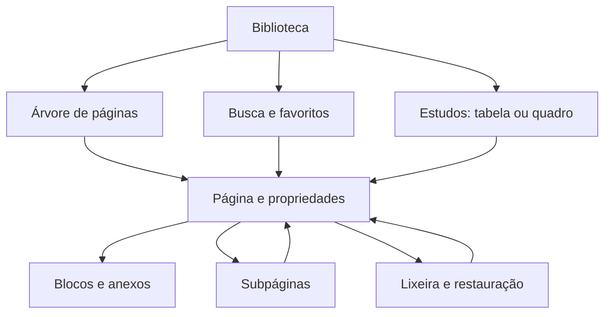

# 03. Mapa de módulos e páginas

## Decomposição da referência

| Módulo | Páginas/seções observadas | Componentes/interações | Evidências |
|---|---|---|---|
| NAV | Lateral, particular, espaço de equipe e caminho superior | Árvore, expansão, menus e navegação | EV-001, EV-009, EV-011–019 |
| PAGE | Terminal, EX-Terminal, Backend e Nova página | Capa, ícone, título, conteúdo e sugestões iniciais | EV-001, EV-010–013, EV-020 |
| EDIT | Corpo e menus de blocos | Conversão, cor, ícone e código | EV-002–008 |
| LIB | Tela Biblioteca | Abas, listagem e ação de novo espaço | EV-016 |
| AUX | Novo chat e comentário vazio | Campo de entrada e sugestões; resultado desconhecido | EV-015, EV-021 |

A tela “Biblioteca” do Notion agrega recursos do workspace; ela não é o mesmo produto que a Biblioteca de Estudos. Uma listagem visual nessa tela não prova que o usuário criou uma base de dados.

## Estrutura proposta para a Biblioteca

| ID | Módulo | Páginas/rotas propostas | Dados | Dependências |
|---|---|---|---|---|
| MOD-01 | Início e navegação | /biblioteca; seção por parâmetro; favoritos/recentes | Resumo das Areas | MOD-02 |
| MOD-02 | Páginas e hierarquia | /biblioteca/paginas/:id | Area, parentId, posição | Base de dados e propriedade do usuário |
| MOD-03 | Editor | Corpo da página, menu /, menu de bloco | JSON Tiptap | MOD-02, MOD-04 |
| MOD-04 | Materiais | Painel de anexos e inserção inline | Attachment | MOD-02, storage atual |
| MOD-05 | Descoberta | Busca global e índice da página | Texto indexável, títulos, favoritos | MOD-02, MOD-03 |
| MOD-06 | Recuperação | /biblioteca/lixeira; versões da página | Lotes de exclusão e PageRevision | MOD-02, controle de versão |
| MOD-07 | Acompanhamento | /biblioteca/estudos; tabela/quadro | Mesmas Areas e StudyView | MOD-02, metadados |
| MOD-08 | Reuso e portabilidade | Modelos; exportar | PageTemplate e pacote de exportação | MOD-03, MOD-04, MOD-06 |

Rotas acima são propostas, não rotas observadas do Notion. Endpoints existentes de /areas podem ser mantidos por compatibilidade.

## Usuários

O perfil alvo é o proprietário de uma biblioteca pessoal autenticada. A infraestrutura pode atender várias contas isoladas. Não há editor convidado, administrador de equipe ou colaboração na versão proposta. Tais perfis aparecem na referência, mas ampliariam permissões e recuperação de conflitos sem necessidade demonstrada pelo objetivo de estudo pessoal.

## Hierarquia funcional

Exemplo proposto: Aplicação → Páginas → Página Terminal → Corpo → Bloco de código → Seletor de linguagem → Ação escolher linguagem → Atualização do documento → Salvamento confirmado. O bloco é parte do documento; a subpágina Exercícios é outra página. Alterar apresentação não deve trocar essa identidade.
