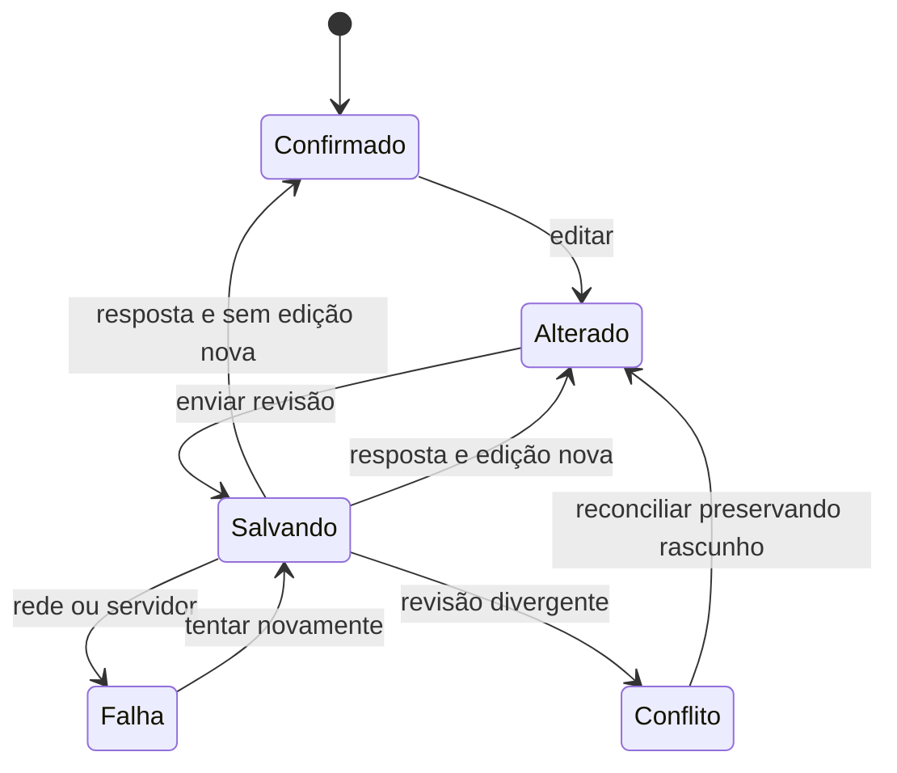

# 06. Matriz de interações e estados

Ator das interações observadas: pessoa operando o Notion no vídeo. Pré-condição comum: sessão existente e página acessível. As exceções de servidor, teclado e persistência não foram exercitadas.

| ID | Origem/elemento | Antes → ação → depois | Feedback visto | Evidência/confiança | O que não se sabe |
|---|---|---|---|---|---|
| INT-001 | Referência de subpágina | Página → acionar contexto → menu de página | Seleção azul e popover | EV-002; alta | Botão/atalho exato que abriu; resultado de excluir/mover |
| INT-002 | Transformar em | Menu → abrir submenu → lista de tipos | Linha selecionada, preview de opção | EV-003; alta | Conversão efetiva e preservação de conteúdo |
| INT-003 | Cor | Menu → abrir Cor → paletas de texto/fundo | Hover e opções | EV-004; alta | Persistência e alcance de uma escolha |
| INT-004 | Editar ícone | Menu → abrir seletor → grade de emojis | Filtro e categorias | EV-005; alta | Busca e mudança específica nesse trecho |
| INT-005 | Documento | Página longa → rolar → outras seções | Viewport muda; lateral permanece | EV-007; alta | Comportamento em mobile |
| INT-006 | Bloco de código | Código → abrir linguagem → lista pesquisável | Popover de linguagem | EV-008; alta | Linguagem aplicada, copiar e feedback de sucesso |
| INT-007 | Caminho superior | Documento → explorar ancestrais → menus em cascata | Níveis revelados | EV-009; alta | Operações de movimentação estrutural |
| INT-008 | Referência EX-Terminal | Página mãe → ativar referência → carregamento → página filha | Placeholder e novo título | EV-010/011; alta para estados | Requisições e estratégia de cache |
| INT-009 | Lateral | Documento → selecionar outro item → outra página | Item/página mudam | EV-012; alta | Estado de edição pendente nessa troca |
| INT-010 | Nova página | Navegação → criação aparente → editor vazio | Placeholder e sugestões | EV-013/017; média para gatilho | Transação de criação, defaults e recarga |
| INT-011 | Guia inicial | Página → menu de guia → opções | Menu de personalização | EV-014; alta | Renomear/excluir guia realmente executados |
| INT-012 | Novo chat / Biblioteca | Lateral → navegação → chat vazio ou listagem | Tela correspondente | EV-015/016; alta | IA respondendo e operações na biblioteca |
| INT-013 | Workspace / particular | Lateral → menus → opções de contexto/ordem | Popovers | EV-018/019; média/alta | Resultado de alterações e permissões |
| INT-014 | Cabeçalho vazio | Página sem capa → personalização → capa e ícone visíveis | Cabeçalho redesenhado | EV-020; alta para resultado | Origem da imagem, upload e durabilidade após recarga |
| INT-015 | Comentário | Página → abrir comentário → campo vazio | Avatar/campo e separador | EV-021; alta | Envio, destinatários e discussão |

## Estados propostos do salvamento

Este diagrama é PROPOSTO, derivado das necessidades de REP-05. “Confirmado” exige resposta do servidor para o conteúdo e os metadados em questão. Rascunho de página nova precisa obter ID antes de anexos e referências. Conflito nunca autoriza reenvio cego que sobrescreva a outra versão.

## Estados propostos da página e anexos

Página: criando → ativa → na lixeira → restaurada ou excluída definitivamente. Erro de criação mantém o texto local e oferece nova tentativa idempotente. Página com ancestor na lixeira não pode aparecer por busca ou link ativo.

Anexo: selecionado → enviando → registrado → disponível. Falha de upload ou de registro não cria um bloco quebrado definitivo; erro é visível e reversível. URL assinada expirada deve ser renovada mediante nova autorização, sem regravar a URL temporária no documento.

## Regras de interação propostas

No editor, `/` abre comandos apenas no contexto apropriado e fora de composição de caracteres. Fora do editor, a busca pode usar Ctrl/Cmd+K. Esc fecha primeiro o menu/modal em foco; não abandona automaticamente a página. Desfazer edição local é diferente de recuperar uma versão já salva. “Voltar” ou “Fechar” não promete reverter o autosave.
