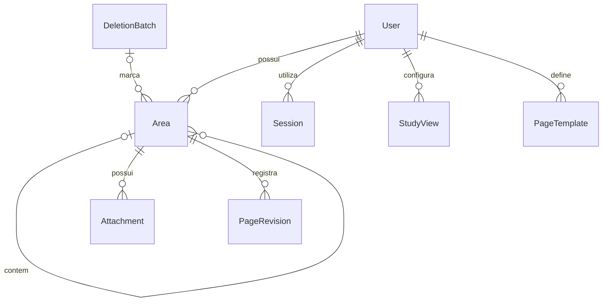

# 10. Modelo conceitual de dados e contratos

**Todo o modelo futuro e todos os novos contratos são PROPOSTOS.** A interface do Notion não revela suas tabelas, APIs ou stack. O modelo existente descrito abaixo vem exclusivamente do repositório.

## Evolução aditiva do modelo atual

Preservar `Area` como entidade de página e `conteudo` como documento Tiptap. Não criar uma tabela por tipo de bloco nem migrar o conteúdo inteiro para um modelo genérico sem necessidade. A mudança de nomenclatura na UI pode ocorrer antes de renomear tabela ou endpoint.

| Entidade | Estado | Campos/relações relevantes |
|---|---|---|
| User / Session | Existentes | Conservar autenticação e segregação por proprietário; nenhuma tabela de equipe necessária |
| Area | Existente, ampliar | id, userId, nome, categoria, section, subSection, nivelEntendimento, icone, conteudo, createdAt, updatedAt |
| Area: hierarquia | Novos campos | parentId opcional, posição persistida; relação recursiva 1:N |
| Area: segurança de escrita | Novos campos | revision inteiro monotônico e contentSchemaVersion; alternativa temporária é updatedAt obrigatório |
| Area: ciclo de vida | Novos campos | deletedAt, deletionBatchId e parentId original preservado; sem cascade físico ao usar lixeira |
| Area: experiência | Novos campos | isFavorite, lastOpenedAt; depois coverAttachmentId, coverPosition e fullWidth |
| Area: busca | Novo derivado | plainText derivado do documento, atualizado na mesma transação; não substituir conteúdo fonte |
| Attachment | Existente, ampliar | id, areaId, tipo, nome e URL legada; adicionar storageKey estável, MIME e tamanho quando recuperáveis |
| DeletionBatch | Proposta P0 | id, userId, raiz, data; identifica uma exclusão de ramo e sua restauração |
| StudyView | Proposta P1 | id, userId, nome, layout, escopo, filtros e ordenações validados |
| PageTemplate | Proposta P1 | id, userId ou origem inicial, nome, documento/schemaVersion, metadados padrão; vínculos de anexos explícitos |
| PageRevision | Proposta P1 | id, areaId, revisão de origem, nome, documento, metadados, schemaVersion, data e referências de anexos retidas |

Para favoritos e recentes, os campos na Area bastam enquanto há um único proprietário. Se compartilhamento entrar futuramente, será necessária modelagem por usuário; não antecipar isso como requisito do MVP.

## Integridade

ParentId sozinho não impede ciclos nem garante mesmo proprietário. Validar no serviço e usar transação com proteção de concorrência estrutural, por exemplo serialização por árvore/proprietário ou isolamento serializável com retry controlado. Uma checagem fora da transação permite A→B e B→A simultâneos.

Movimento entre seções atualiza o ramo; status/categoria/entendimento permanecem próprios de cada página. Ordenação precisa de desempate estável. Migrações não devem impor unicidade de título, porque títulos repetidos são permitidos.

Blocos têm identidade lógica no JSON (`blockId` onde a operação exigir), tipo e atributos validados. Referência interna guarda `targetPageId`; mídia guarda `attachmentId`; linguagem é atributo do código. Reordenar blocos altera o documento, não a hierarquia de páginas. Novas propriedades devem preservar o schema Tiptap e suas extensões; não acrescentar envelopes arbitrários sem adaptador.

Exclusão de anexo precisa verificar referência no documento atual, capa, modelos e versões. Na segunda entrega, versões retêm os anexos necessários para sua restauração. Purge tem política explícita de cascata dessas referências. Duplicação cria cópias de objetos, evitando que apagar um original quebre a cópia.

## Contratos existentes observados

REP-02: `GET/POST /areas`, `GET/PATCH/DELETE /areas/:id`. A listagem recebe section, subSection, page e limit. O update pode receber updatedAt, mas ele é opcional no código atual. REP-06/03: anexos são listados por areaId e enviados por `POST /attachments/upload` com multipart.

O DELETE atual remove arquivos e Area; não o descrever como lixeira. A evolução deve manter o cliente antigo desativado ou compatível para que um DELETE legado não contorne a política nova.

## Contratos propostos

Nomes são ilustrativos e devem ser ajustados às convenções existentes. Nenhum endpoint foi implementado nesta análise.

| Operação | Entrada | Saída | Validações/erros principais |
|---|---|---|---|
| POST /areas | nome/defaults, section, parentId opcional; chave de idempotência | Página e revision | Pai ativo/próprio; mesmo pedido retorna mesmo ID |
| GET /areas?parentId=… | pai/raízes, filtros e paginação | Metadados, hasChildren, próximo cursor | Sem conteúdo integral por padrão; propriedade e lixeira |
| GET /areas/:id | ID | Documento, metadados, ancestrais, revision, anexos autorizados | 404 para recurso indisponível; lixeira por fluxo separado |
| PATCH /areas/:id | campos alterados, expectedRevision, schemaVersion aplicável | Representação atual e nova revision | 409 conflito; 400/422 validação; 413 limite efetivo |
| POST /areas/:id/move | targetParentId ou raiz, seção destino, posição, revisão esperada | Ramo/mudanças de metadados, revisões afetadas | Ciclo, pai inválido, conflito estrutural; transação |
| POST /areas/:id/trash | expectedRevision | deletionBatchId e quantidade afetada | Atomicidade; não apagar objetos |
| POST /trash/:batchId/restore | destino opcional autorizado | IDs restaurados e eventual novo pai | Lotes anteriores preservados; pai ausente tratado |
| DELETE /trash/:batchId | confirmação explícita e revisão do lote | Resultado/pendingCleanup identificável | Sem relatar limpeza completa se storage falhou |
| GET /search | q, seção/status opcionais, cursor | IDs, títulos, trecho e caminho | Consulta global autorizada; limites/ordenação estáveis |
| PATCH /areas/:id/favorite | favorito, revisão quando acoplada à Area | Estado atualizado | Página própria; não clonar |
| POST /attachments/upload | file e areaId | attachmentId e metadados + URL temporária | Área ativa, tipo/tamanho, compensação |
| GET /attachments/:id/content-url | ID | URL autorizada e validade | Propriedade; não gravar URL no documento |
| POST /areas/:id/duplicate | includeChildren, destino, revisão | Nova raiz/estado da operação | Cópia independente, compensação de arquivos |
| GET/POST/PATCH /study-views | configuração validada | View por usuário | Campos/operadores permitidos |
| POST /templates/:id/apply | destino e parâmetros do rascunho | Nova página | Novos IDs, não sincronizado |
| POST /areas/:id/revisions | nome, expectedRevision | Snapshot confirmado | Preservar arquivos usados |
| POST /areas/:id/revisions/:rid/restore | expectedRevision | Nova revisão atual | Snapshot anterior preservado; 409 em conflito |
| POST /exports | IDs/escopo/includeTrash | Pacote ou operação consultável | Snapshot consistente, autorização, falhas explícitas |

## Formato de erro e semântica de escrita

Padronizar códigos de aplicação, por exemplo `VERSION_CONFLICT`, `INVALID_PARENT`, `CYCLE_DETECTED`, `UNSUPPORTED_DOCUMENT_SCHEMA`, `UPLOAD_REJECTED`. Mensagem orienta ação; requestId ajuda diagnóstico; detalhes não incluem tokens ou notas privadas. As respostas devem manter compatibilidade com o tratamento atual de erros ou incluir adaptador.

Em um PATCH, o servidor compara revisão e grava numa única operação transacional. Resposta devolve revisão nova. O cliente confirma apenas o estado enviado; se o usuário continuou digitando, o estado segue alterado e a fila envia a versão mais recente. Atualizar metadados em tabela deve usar o mesmo mecanismo e não sobrescrever `conteudo` desnecessariamente.

## Migração dos dados

1. Inventariar formatos existentes sem expor notas privadas. Há adaptador de texto legado `{texto}` no frontend; sua presença não prova a quantidade de registros nesse formato.
2. Fazer backup consistente e ensaiar restauração.
3. Adicionar campos/tabelas de forma compatível; Areas existentes ficam com parentId nulo e ordem determinística.
4. Converter apenas formatos conhecidos com transformação determinística e repetível, preservando fonte e registrando falhas; nenhuma perda silenciosa de blocos.
5. Preparar readers compatíveis antes dos writers que emitem novos blocos; impedir cliente antigo de apagar tipos desconhecidos.
6. Reconciliar contagens, IDs, metadados, conteúdo e arquivos, testar fluxos e liberar por etapa.

Não executar reset, seed de conteúdo, renomeação destrutiva ou exclusão de tabelas para “começar limpo”. Esses procedimentos não fazem parte da proposta.
