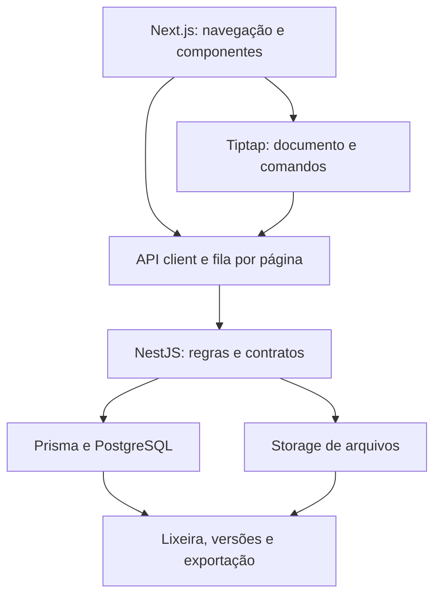

# 11. Proposta arquitetural e decisões

## Diagnóstico do projeto atual

REP-07 confirma a stack existente. Manter Next.js/React no frontend, NestJS no backend, Prisma/PostgreSQL para dados, storage compatível com S3 e Tiptap para documentos. Essa escolha aproveita código real; não é uma afirmação sobre a arquitetura do Notion.

REP-03 mostra que `page.tsx` concentra autenticação, listagem, seleção, editor, salvamento e anexos. `EditorLayout.tsx` já oferece componentes reaproveitáveis. O fluxo ativo de edição usa EditorContent diretamente em AreaForm; analisar apenas `AreaEditor.tsx` levaria a conclusões erradas sobre controles habilitados.

## Matriz de decisões

| ID | Problema | Alternativas | Recomendação e razão | Custo/risco e validação |
|---|---|---|---|---|
| ADR-001 | Acrescentar páginas sem perder biblioteca | Nova entidade Page; expandir Area | Expandir Area e chamar Página na UI; preservar IDs, rotas de API e anexos | Nome histórico fica na API; documentar mapeamento e migrar aditivamente |
| ADR-002 | Representar blocos | Tabela por bloco; documento JSON | Continuar com JSON Tiptap versionado; suficiente para edição pessoal | Conflitos no documento inteiro; snapshots maiores; medir tamanho real |
| ADR-003 | Editor semelhante ao fluxo visto | Reescrever editor; trocar motor; estender Tiptap | Estender motor atual e avaliar extensões por requisito | Fazer prova técnica de menu, seleção, drag e nós customizados antes de fechar bibliotecas |
| ADR-004 | Navegação persistente | Somente state; rotas por ID | Rotas do App Router com ID estável e dados carregados por página | Compatibilizar seleção e URL; consultar docs locais de Next indicadas por AGENTS.md |
| ADR-005 | Organizar frontend | Continuar monolítico; módulos por domínio | Separar pages, editor, attachments, search, study-views e API client conforme convenções | Refatorar em fatias com regressão; não reescrever autenticação por conveniência |
| ADR-006 | Evitar perda de edições | Last-write-wins; timestamp; revisão inteira | Reutilizar fila; exigir precondição no servidor, preferindo revision explícita após migração | Adaptar todos os escritores, inclusive metadados; duas abas devem produzir conflito controlado |
| ADR-007 | Busca | Filtragem local; serviço externo; PostgreSQL | Busca no servidor usando título/categoria/texto derivado; medir antes de escolher índice | Busca japonesa exige teste específico; full-text com tokenização inadequada pode falhar. Começar com semântica clara de substring se volume permitir |
| ADR-008 | Tabela/quadro | Engine universal de bases; views do domínio | Views sobre Area com campos fixos; entrega objetivo de estudos | Não oferece propriedades arbitrárias, fórmulas ou rollups; registrar essa fronteira no produto |
| ADR-009 | Arquivos e capas | URL no JSON; identidade estável | Attachment por ID e storageKey; URLs temporárias só na resposta | Backfill de URLs antigas e referências em versões precisam de plano |
| ADR-010 | Recuperação | Exclusão física; soft delete simples; lote | Lixeira com lote para ramo e purge separado | Restaurar sem ressuscitar exclusões anteriores; implementar limpeza de objetos recuperável |
| ADR-011 | Colaboração | CRDT/WebSocket; edição pessoal com conflito | Edição pessoal e conflitos explícitos na v1 | Colaboração futura exigirá revisão do modelo de salvamento; não afirmar que basta adicionar WebSocket |
| ADR-012 | Portabilidade | Apenas Markdown; JSON; pacote completo | JSON versionado + Markdown de leitura + manifesto + arquivos | Exportação não é importador de Notion; formatos sem equivalente devem informar limitações |

Todas as ADRs estão propostas, com confiança média de adequação; a validação de código e dados da fase F0 fecha os detalhes. A arquitetura mínima dispensa Redis, motor de busca externo, microserviços, IA e sincronização offline nesta etapa. Uma limpeza de storage repetível pode começar no backend existente, com estado de pendência persistido, antes de adotar infraestrutura de filas.

## Fronteiras técnicas

O diagrama representa responsabilidades da proposta. Não exige que recuperação seja um serviço separado.

## Pontos de atenção extraídos do código

| ID | Evidência | Implicação para o plano |
|---|---|---|
| GAP-01 | page.tsx:110 verifica INPUT/TEXTAREA/SELECT, mas não contenteditable no atalho global / | Há risco de interceptar o comando / do editor; validar em execução e restringir pelo contexto |
| GAP-02 | page.tsx:146 filtra `areas` já carregadas | A busca atual não cobre toda a biblioteca; não renomeá-la “global” sem mudar backend |
| GAP-03 | page.tsx:425 produz só o item atual ou headings; seleção só trata índice | A sidebar atual não é uma árvore de páginas; é preciso mudar dados e eventos |
| GAP-04 | `onNew={onCancel}` no editor ativo | Botão de novo item está ligado a fechar formulário; redefinir fluxo de criação em vez de copiar aparência |
| GAP-05 | autosave envia `conteudo`; dirty visual deriva de conteúdo/autosaving | Metadados podem não estar representados pelo estado visual; ensaiar e unificar rastreamento de alterações |
| GAP-06 | Esc chama onCancel; Voltar/Cancelar usam fechamento | Saída pode abandonar edição pendente; investigar e implementar guarda/recuperação |
| GAP-07 | updatedAt é opcional no DTO/serviço | Controle existe, mas não protege clientes que omitam precondição; novo contrato deve torná-la obrigatória |
| GAP-08 | DELETE remove objetos antes de apagar Area | Lixeira exige mudar o ciclo de vida; falha parcial de storage precisa ser recuperável |
| GAP-09 | DTO aceita objeto com teto declarado de 50 MiB | Limite declarado não comprova limite efetivo do parser/proxy nem bom desempenho; validar schema, payload e ambiente |
| GAP-10 | pacote contém extensões declaradas além das registradas; painel ativo desabilita underline/link | Dependência instalada não prova recurso disponível; fechar catálogo com comandos realmente registrados |

Os itens acima são constatações de código e riscos derivados, não bugs reproduzidos em produção. Não se deve atribuir nota de segurança, performance ou qualidade ao sistema sem executar as verificações.

## Sequência técnica segura

Preparar formatos, contratos e mecanismos de recuperação antes de novos gestos do editor. Criar estruturas aditivas, depois navegação e editor; somente depois habilitar os writers de novos tipos. Migrar e validar dados antes de liberar a UI que depende deles. Manter feature flags ou outra estratégia simples de liberação por capacidade, se compatível com o projeto.
